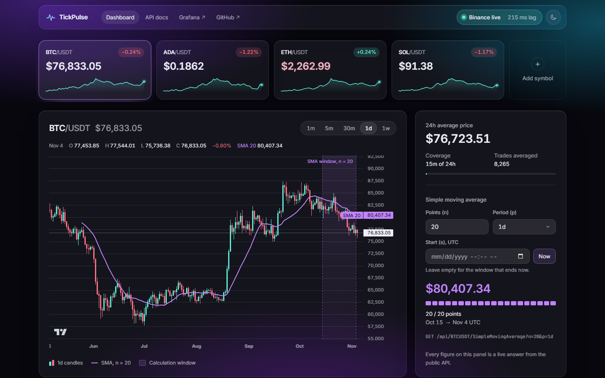
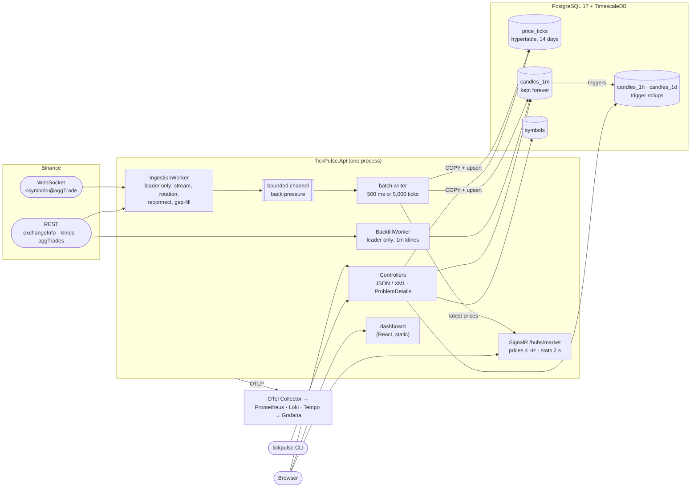

# TickPulse

TickPulse collects Binance spot trades over a single WebSocket connection, stores them in
PostgreSQL with TimescaleDB, and serves the 24-hour average price and simple moving averages over a
JSON/XML HTTP API. Admins change the monitored symbols at runtime, a console client offers the same
analytics, and a live dashboard and Grafana show prices and system health.

TickPulse is designed to run at the addresses below. The deployment pipeline is ready; the first
deploy waits on the owner's one-time steps in [docs/deployment.md](docs/deployment.md#first-time-server-setup).
Until then, [the quick start](#quick-start) runs the same stack locally.

- **App:** <https://tickpulse.dev>
- **API reference (Scalar):** <https://tickpulse.dev/docs>
- **Grafana:** <https://grafana.tickpulse.dev> (anonymous, read-only). Anyone can read the raw log
  lines, exception messages included. The collector scrubs addresses and headers, and the logs never
  contain secrets ([data exposure](deploy/observability/README.md#query-cost-and-data-exposure)).



**Contents:** [Architecture](#architecture) · [Quick start](#quick-start) ·
[Configuration](#configuration) · [Database initialisation](#database-initialisation) ·
[API reference](#api-reference) · [Console client](#console-client) · [Tests](#running-the-tests) ·
[Repository layout](#repository-layout) · [Further reading](#further-reading)

## Architecture

One deployable process: the ASP.NET Core API, which also serves the dashboard and a SignalR hub,
plus two hosted workers. A PostgreSQL advisory lock makes exactly one instance the ingestion leader;
every instance serves the API.



The code is layered, and `tests/TickPulse.Architecture.Tests` enforces it:

```
Domain ← Application ← Infrastructure ← Api      Contracts ← Api      Contracts ← Cli
```

The design is in [the design spec](docs/superpowers/specs/2026-11-03-tickpulse-design.md), the
decisions in [docs/adr/](docs/adr/README.md), and the reasoning and the build process in
[engineering-notes.md](engineering-notes.md).

## Quick start

Needs Docker with a recent Docker Compose (tested with Compose 5.1). From the repository root:

```bash
docker compose up
```

This builds the images, starts TimescaleDB and the API, applies the migrations, seeds `BTCUSDT`,
`ADAUSDT` and `ETHUSDT`, starts streaming trades from Binance, and backfills about six months of
1-minute candles per symbol: about 2 minutes per symbol, one after another, so about 6 minutes for
the three on first start.

- Dashboard: <http://localhost:8080>
- API reference: <http://localhost:8080/docs>
- Health: <http://localhost:8080/health/ready>

```bash
curl -s localhost:8080/api/BTCUSDT/24hAvgPrice
curl -s -H "Accept: application/xml" "localhost:8080/api/BTCUSDT/SimpleMovingAverage?n=20&p=1d"
curl -s -H "X-Api-Key: local-dev-admin-key-not-for-production" localhost:8080/api/admin/symbols

docker compose run --rm cli avg BTCUSDT          # console client, against the api container
docker compose --profile observability up -d     # plus OTel Collector, Prometheus, Loki, Tempo, Grafana on :3000
docker compose --profile observability down -v   # stop everything and delete the data
```

`local-dev-admin-key-not-for-production` is a local default. Copy `.env.example` to `.env` to change it,
or any other port or setting. The observability stack is described in
[deploy/observability/README.md](deploy/observability/README.md), and the production deployment in
[docs/deployment.md](docs/deployment.md).

## Configuration

Standard ASP.NET Core configuration: `appsettings.json`, then environment variables, where `:`
becomes `__` (`Admin:ApiKey` → `Admin__ApiKey`). Invalid values fail at startup with the key named.

| Key | Default | Meaning |
|---|---|---|
| `ConnectionStrings:TickPulse` | *(required)* | Npgsql connection string. Startup fails without it. |
| `Database:RunMigrationsOnStartup` | `true` | Apply EF Core migrations and the seed before the workers start. |
| `Database:MaxPoolSize` | `20` | Size of the shared Npgsql pool, unless the connection string sets `Maximum Pool Size`. The tick writer and the leader lock add 5 connections; the total is checked against `max_connections` at startup. |
| `Database:AllowGssEncryption` | `false` | TickPulse forces GSS encryption off on every connection, because the native Kerberos probe crashed the API under load. `true` keeps an explicit mode from the connection string and needs a custom image with krb5 installed. |
| **Admin** | | |
| `Admin:ApiKey` | *(empty)* | Key for `X-Api-Key`. Empty or unset disables the admin endpoints (403). Surrounding whitespace fails startup. Fewer than 32 characters fails startup in the Production environment (the container images) and logs a warning elsewhere. |
| `Admin:MaxActiveSymbols` | `20` | Most symbols active at once, 1–1000. |
| **Binance** | | |
| `Binance:WsBaseUrl` | `wss://stream.binance.com:9443` | WebSocket base URL; `/stream` is appended. |
| `Binance:RestBaseUrl` | `https://api.binance.com` | REST base URL for `exchangeInfo`, `klines` and `aggTrades`. |
| **Ingestion** | | |
| `Ingestion:RotationInterval` | `23:00:00` | Connection age at which it is replaced, make-before-break. Must be under 24 h. |
| `Ingestion:BatchMaxSize` | `5000` | A batch is written once it holds this many ticks. |
| `Ingestion:BatchMaxDelay` | `00:00:00.500` | …or at the latest this long after its first tick. |
| `Ingestion:ChannelCapacity` | `100000` | Bound of the tick channel; when full, reading the WebSocket waits. |
| `Ingestion:ReconcileInterval` | `00:00:30` | How often subscriptions are compared with the active symbols in the database. |
| `Ingestion:LeaderRetryInterval` | `00:00:10` | How often a standby instance tries to take the leader lock. |
| `Ingestion:LeaderCheckInterval` | `00:00:05` | How often the leader probes its lock connection. |
| **Backfill** | | |
| `Backfill:Enabled` | `false` | Fetch historical 1-minute klines for long-period SMAs. `true` in `docker-compose.yml` and production. |
| `Backfill:Depth` | `182.00:00:00` | How far back the backfill reaches, 1 minute to 1,095 days. |
| **HTTP** | | |
| `RateLimiting:PermitLimit` | `300` | Requests per client per window on the API controllers (IPv4 address or IPv6 /64). |
| `RateLimiting:WindowSeconds` | `60` | Length of that fixed window. |
| `MarketHub:ConnectPermitLimit` | `60` | Hub connection attempts per client per window. |
| `MarketHub:ConnectWindowSeconds` | `60` | Length of that fixed window. |
| `SystemStats:CacheTtl` | `00:00:02` | How long the stored-row counts in the stats are reused. |
| `SystemStats:ReadTimeout` | `00:00:01` | How long one read of those counts may take before the last-known values are used. |
| `ForwardedHeaders:KnownProxies` | *(none)* | Proxy IPs, besides loopback, whose `CF-Connecting-IP` is trusted as the client IP. An array or one comma-separated value. |
| `ForwardedHeaders:KnownNetworks` | *(none)* | The same as CIDR ranges, e.g. the Docker network. `X-Forwarded-For` is never read. |
| **Telemetry** | | |
| `Otel:Endpoint` | *(empty)* | OTLP gRPC endpoint for traces, metrics and logs, e.g. `http://otel-collector:4317`. Empty switches export off. |
| `Otel:SampledRequestsPerSecond` | `10` | Ordinary requests per second that keep their trace and Information log line; errors, 4xx other than 429, and slow requests are always kept. |
| `Otel:FlushSampleRatio` | `0.1` | Share of `ingest.flush` traces kept, 0–1. |
| `Otel:IpSalt` | *(random per process)* | Salt of the daily client-IP hash in logs. Set it to keep hashes stable across restarts. |
| `Serilog:MinimumLevel:*` | `Information`, with framework categories at `Warning` | Log levels, per category. |

The standard OpenTelemetry variables also apply; the compose files set `OTEL_METRIC_EXPORT_INTERVAL`
to `15000` because the dashboards expect 15 s exports. `docker-compose.yml` maps its own variables
(`ADMIN_API_KEY`, `API_PORT`, `OTEL_ENDPOINT`, …) onto these keys; `.env.example` lists them.

## Database initialisation

On startup the API applies the EF Core migrations before any worker starts (`DatabaseMigrator`). The
migrations:

1. `CREATE EXTENSION IF NOT EXISTS timescaledb` (the database user needs the privilege, or the
   extension must already exist);
2. create `symbols` and seed `BTCUSDT`, `ADAUSDT` and `ETHUSDT`;
3. create `price_ticks` as a hypertable with 1-day chunks, compression after 2 days and retention of
   14 days;
4. create `candles_1m`, and the `candles_1h` and `candles_1d` rollups with the triggers that maintain
   them.

Transient connection errors are retried (5 attempts, 1/2/4/8 s apart, 2 minutes in total); after that
startup fails and the container's restart policy takes over.

To manage the schema yourself, set `Database__RunMigrationsOnStartup=false` and apply an idempotent
script generated from the migrations:

```bash
dotnet tool restore
dotnet ef migrations script --idempotent \
  --project src/TickPulse.Infrastructure --startup-project src/TickPulse.Infrastructure -o tickpulse.sql
psql "<connection string>" -f tickpulse.sql
```

## API reference

The interactive reference is at `/docs` (Scalar), the OpenAPI 3.1 document at `/openapi/v1.json`.

| Method | Route | Purpose |
|---|---|---|
| `GET` | `/api/{symbol}/24hAvgPrice` | Mean price of the trades collected in `[now − 24 h, now]` |
| `GET` | `/api/{symbol}/SimpleMovingAverage?n=&p=&s=` | SMA of `n` complete bucket closes, `p ∈ {1w, 1d, 30m, 5m, 1m}` |
| `GET` | `/api/{symbol}/candles?p=&limit=` | OHLCV candles, oldest first, the last one still open; `limit` 1–1000, default 300 |
| `GET` | `/api/symbols` | Every symbol with its latest price, 24h change and backfill status |
| `GET` | `/api/system/stats` | Ingestion state, lag, ticks/s, rows stored, uptime, version |
| `GET` | `/api/admin/symbols` | Admin: every symbol with its history state |
| `GET` | `/api/admin/symbols/{symbol}` | Admin: one symbol |
| `POST` | `/api/admin/symbols` | Admin: add or reactivate `{"symbol":"…"}`; `201` + `Location`, or `200` if already active |
| `DELETE` | `/api/admin/symbols/{symbol}` | Admin: deactivate (history is kept); `204` |
| `GET` | `/health/live`, `/health/ready` | Liveness; readiness (database answers, ingestion connected or standing by) |
| WebSocket | `/hubs/market` | SignalR: `Subscribe(symbol)`, then `price` messages; `stats` every 2 s |

Symbols are case-insensitive (`btcusdt` works). Responses are JSON by default and XML when `Accept`
prefers it; a request that accepts neither gets `406`. Admin routes need `X-Api-Key`. `HEAD` works
wherever `GET` does.

Every response carries `nosniff`, `Referrer-Policy: no-referrer`, `X-Frame-Options: DENY` and a
`Content-Security-Policy` that allows only this origin and no inline script. The one exception is
`/docs`: Scalar boots from an inline script, so its policy allows inline scripts, still from this
origin only (Scalar's CDN fonts, telemetry and AI agent are switched off). See
`src/TickPulse.Api/Hosting/SecurityHeaders.cs`.

### 24h average

```bash
curl -s localhost:8080/api/BTCUSDT/24hAvgPrice
```

```json
{"symbol":"BTCUSDT","averagePrice":78292.65925926,"from":"2026-11-04T07:30:26.356Z","to":"2026-11-04T07:30:38.698Z","coveredSeconds":12,"sampleCount":162,"windowHours":24}
```

The average is the arithmetic mean of every collected trade, not a volume-weighted price, so it differs
from Binance's `weightedAvgPrice` ([ADR 0002](docs/adr/0002-24h-average-is-the-arithmetic-mean.md)).
`from`, `to`, `coveredSeconds` and `sampleCount` say how much of the window the data covers; the
example above is from a stack that had been running for 12 seconds
([ADR 0003](docs/adr/0003-partial-window-reports-its-coverage.md)).

```bash
curl -s -H "Accept: application/xml" localhost:8080/api/btcusdt/24hAvgPrice
```

```xml
<averagePrice xmlns:i="http://www.w3.org/2001/XMLSchema-instance" xmlns="https://tickpulse.dev/schema/v1"><symbol>BTCUSDT</symbol><averagePrice>78278.85916667</averagePrice><from>2026-11-04T07:30:26.356Z</from><to>2026-11-04T07:30:45.715Z</to><coveredSeconds>19</coveredSeconds><sampleCount>336</sampleCount><windowHours>24</windowHours></averagePrice>
```

### Simple moving average

Without `s`, the window is the last `n` complete buckets before now. With `s` (ISO-8601; UTC when it has
no offset), it starts at the first bucket at or after `s` and runs forward `n` buckets
([ADR 0005](docs/adr/0005-sma-start-parameter-anchors-the-window-start.md)). Weeks start Monday 00:00
UTC. Empty buckets are skipped and reported through `actualDataPoints`
([ADR 0006](docs/adr/0006-sparse-buckets-are-skipped-not-filled.md)).

```bash
curl -s "localhost:8080/api/BTCUSDT/SimpleMovingAverage?n=3&p=1d"
```

```json
{"symbol":"BTCUSDT","period":"1d","requestedDataPoints":3,"actualDataPoints":3,"value":77541.28666667,"windowStart":"2026-11-01T00:00:00Z","windowEnd":"2026-11-04T00:00:00Z","referenceTime":"2026-11-04T07:43:20.2001731Z","startParameter":null,"dataPoints":[{"bucketStart":"2026-11-01T00:00:00Z","close":78354.00000000},{"bucketStart":"2026-11-02T00:00:00Z","close":76816.00000000},{"bucketStart":"2026-11-03T00:00:00Z","close":77453.86000000}]}
```

```bash
curl -s -H "Accept: application/xml" "localhost:8080/api/BTCUSDT/SimpleMovingAverage?n=3&p=1d&s=2026-10-01T00:00:00Z"
```

```xml
<sma xmlns:i="http://www.w3.org/2001/XMLSchema-instance" xmlns="https://tickpulse.dev/schema/v1"><symbol>BTCUSDT</symbol><period>1d</period><requestedDataPoints>3</requestedDataPoints><actualDataPoints>3</actualDataPoints><value>84717.20666667</value><windowStart>2026-10-01T00:00:00Z</windowStart><windowEnd>2026-10-04T00:00:00Z</windowEnd><referenceTime>2026-11-04T07:43:20.4636762Z</referenceTime><startParameter>2026-10-01T00:00:00Z</startParameter><dataPoints><dataPoint><bucketStart>2026-10-01T00:00:00Z</bucketStart><close>84880.05000000</close></dataPoint><dataPoint><bucketStart>2026-10-02T00:00:00Z</bucketStart><close>84518.01000000</close></dataPoint><dataPoint><bucketStart>2026-10-03T00:00:00Z</bucketStart><close>84753.56000000</close></dataPoint></dataPoints></sma>
```

Validation: `n` 1–1000 and required, `p` one of the five periods and required, `s` not in the future.

### Symbols, candles and stats

```bash
curl -s localhost:8080/api/symbols
curl -s "localhost:8080/api/BTCUSDT/candles?p=1d&limit=2"
curl -s localhost:8080/api/system/stats
```

```json
[{"bucketStart":"2026-11-03T00:00:00Z","open":76816.01000000,"high":78063.30000000,"low":76388.88000000,"close":77453.86000000,"volume":12560.17626000},{"bucketStart":"2026-11-04T00:00:00Z","open":77453.85000000,"high":78374.42000000,"low":75736.38000000,"close":78126.86000000,"volume":6919.14108000}]
```

`change24hPercent` on `/api/symbols` is `null` until a reliable day-ago close exists, for example while a
new symbol's backfill is still running.

### Admin

```bash
K="X-Api-Key: local-dev-admin-key-not-for-production"
curl -s -i -H "$K" -H "Content-Type: application/json" -d '{"symbol":"solusdt"}' localhost:8080/api/admin/symbols
curl -s -H "$K" localhost:8080/api/admin/symbols/SOLUSDT
curl -s -i -X DELETE -H "$K" localhost:8080/api/admin/symbols/SOLUSDT
```

```text
HTTP/1.1 201 Created
Location: /api/admin/symbols/SOLUSDT

{"symbol":"SOLUSDT","isActive":true,"createdAt":"2026-11-04T07:30:56.007842Z","deactivatedAt":null,"backfillStatus":"Pending","backfilledFrom":null}
```

Request bodies can be XML too:

```bash
curl -s -H "$K" -H "Content-Type: application/xml" -H "Accept: application/xml" \
  -d '<addSymbolRequest xmlns="https://tickpulse.dev/schema/v1"><symbol>SOLUSDT</symbol></addSymbolRequest>' \
  localhost:8080/api/admin/symbols
```

A symbol must match `^[A-Za-z0-9]{5,20}$` and be `TRADING` on Binance spot. Removing a symbol stops its
subscription and keeps its history, which stays queryable; adding it again reactivates it and backfills
the stretch it was inactive ([ADR 0008](docs/adr/0008-removing-a-symbol-deactivates-it.md)).

### Errors

Every error is an RFC 9457 problem, negotiated like a success: `application/problem+json`, or
`application/problem+xml` when `Accept` prefers XML. The `type` is
`https://tickpulse.dev/problems/{slug}`.

```bash
curl -s -H "Accept: application/xml" localhost:8080/api/NOPEUSDT/24hAvgPrice
```

```xml
<problem xmlns="urn:ietf:rfc:7807"><detail>Symbol 'NOPEUSDT' is not monitored.</detail><status>404</status><title>Unknown symbol</title><type>https://tickpulse.dev/problems/unknown-symbol</type><traceId>00-72e44277496cb8fa513428e23530d46b-ed77e62a16f518b1-00</traceId></problem>
```

```bash
curl -s "localhost:8080/api/BTCUSDT/SimpleMovingAverage?n=0&p=1d"
```

```json
{"type":"https://tickpulse.dev/problems/validation","title":"Validation failed","status":400,"detail":"n must be between 1 and 1000.","errors":{"n":["n must be between 1 and 1000."]},"traceId":"00-c95c41f869b3a5328296c98372a9058a-c41e914550a58c0c-00"}
```

| Status | Slug | When |
|---|---|---|
| 400 | `validation` | a missing or invalid parameter; `errors` names it |
| 401 | `unauthorized` | admin route without a key, or with a wrong one |
| 403 | `admin-disabled` | admin route while no admin key is configured |
| 404 | `unknown-symbol` | the symbol is malformed or was never monitored |
| 404 | `no-data` | the window holds no data |
| 404 | `not-found` | no route matches the path |
| 405 | `method-not-allowed` | the route exists but not for this method; `Allow` lists the methods |
| 406 | `not-acceptable` | `Accept` allows neither JSON nor XML |
| 409 | `symbol-limit` | adding one more would exceed `Admin:MaxActiveSymbols` |
| 415 | `unsupported-media-type` | a request body that is neither JSON nor XML |
| 422 | `invalid-symbol` | the symbol is not trading on Binance spot |
| 429 | `rate-limited` | over the rate limit; `Retry-After` is the time left in the window |
| 500 | `internal` | an unexpected error; a generic detail and the `traceId`, nothing from the exception |
| 503 | `upstream-unavailable` | Binance could not confirm a symbol being added |

### Live updates

The SignalR hub at `/hubs/market` (JSON protocol) pushes the latest trade per subscribed symbol up to
four times a second, and the `/api/system/stats` document every 2 seconds:

```js
const hub = new signalR.HubConnectionBuilder().withUrl("/hubs/market").build();
hub.on("price", (p) => console.log(p.symbol, p.price, p.tradeTime));
hub.on("stats", (s) => console.log(s.wsStatus, s.ingestLagMs));
await hub.start();
await hub.invoke("Subscribe", "BTCUSDT"); // true when subscribed
```

## Console client

`TickPulse.Cli` (command `tickpulse`) talks to the HTTP API only. It renders tables and charts, or,
with `--format json|xml`, prints the API's raw body.

```bash
dotnet run --project src/TickPulse.Cli -- avg BTCUSDT
dotnet run --project src/TickPulse.Cli -- sma BTCUSDT -n 20 -p 1d
dotnet run --project src/TickPulse.Cli -- sma ETHUSDT -n 12 -p 5m -s 2026-10-01T09:00:00Z --format xml
dotnet run --project src/TickPulse.Cli -- watch ETHUSDT -n 30 -p 1m --interval 5s
dotnet run --project src/TickPulse.Cli -- symbols list
dotnet run --project src/TickPulse.Cli -- symbols add BNBUSDT --api-key <key>
dotnet run --project src/TickPulse.Cli -- symbols remove BNBUSDT --api-key <key>

docker compose run --rm cli sma BTCUSDT -n 20 -p 1d    # the same, against the compose stack
```

| Command | Does |
|---|---|
| `avg <symbol>` | 24h average with its coverage |
| `sma <symbol> -n <points> -p <period> [-s <start>]` | SMA as a table and a bar chart |
| `watch <symbol> [-n -p] [-i <interval>]` | live price, direction, 24h change and sparkline, optionally with an SMA; Ctrl+C exits |
| `symbols [list]` | symbols with price and 24h change; with a key, the admin view |
| `symbols add <symbol>` / `symbols remove <symbol>` | admin; needs the key |

| Global option | Default |
|---|---|
| `--api-url` | `TICKPULSE_API_URL`, else `https://tickpulse.dev` |
| `--format`, `-f` | `table`; `json` or `xml` print the raw body |
| `--api-key`, `-k` | `TICKPULSE_API_KEY`; sent as `X-Api-Key` and never echoed |

| Exit code | Meaning |
|---|---|
| 0 | success |
| 1 | the API rejected the request (4xx: unknown symbol, validation, bad key, …) |
| 2 | the API is unreachable, timed out, failed (5xx) or sent an unreadable body |
| 64 | invalid command line; nothing was sent |
| 70 | internal error in the CLI |
| 130 | interrupted with Ctrl+C (`watch` exits with 0 instead) |

`dotnet pack src/TickPulse.Cli -c Release` builds it as a .NET tool named `tickpulse`.

## Running the tests

```bash
dotnet test TickPulse.slnx                    # everything; needs Docker running (Testcontainers)
dotnet test tests/TickPulse.Domain.Tests      # fast, no Docker
npm --prefix web ci && npm --prefix web test  # dashboard (Vitest)
```

| Project | What |
|---|---|
| `TickPulse.Domain.Tests` | periods, Monday weeks, SMA windows, rounding (TDD) |
| `TickPulse.Application.Tests` | use cases: analytics, admin, ingestion state |
| `TickPulse.Integration.Tests` | real TimescaleDB (Testcontainers, the production image), the API through `WebApplicationFactory`, a fake Binance server (WebSocket and REST), telemetry |
| `TickPulse.Cli.Tests` | every command against a stub HTTP handler, on a fake clock |
| `TickPulse.Architecture.Tests` | layering rules |
| `web/` | dashboard hooks, sections and formatting (Vitest) |

Current test counts and coverage are in
[engineering-notes.md](engineering-notes.md#by-the-numbers). CI runs every test on every pull request,
along with `dotnet format --verify-no-changes`, the web lint, typecheck and build, and a coverage gate
(Domain ≥ 95 % lines, overall ≥ 80 %). Coverage locally:

```bash
dotnet tool restore
dotnet test TickPulse.slnx -c Release --collect "XPlat Code Coverage" --results-directory coverage
dotnet tool run reportgenerator -reports:"coverage/**/coverage.cobertura.xml" -targetdir:coverage/report -reporttypes:TextSummary
```

## Repository layout

```
src/
  TickPulse.Domain/          pure types and math: Period, SymbolName, SmaWindow, calculators
  TickPulse.Application/     use cases and ports: analytics, symbol admin, ingestion state
  TickPulse.Infrastructure/  EF Core migrations, Npgsql reads and writes, Binance WS and REST,
                             leader lock, ingestion and backfill workers, metrics
  TickPulse.Contracts/       DTOs shared by the API and the CLI (JSON + DataContract XML)
  TickPulse.Api/             composition root: controllers, problems, auth, rate limiting,
                             SignalR hub, health, OpenAPI, telemetry, static dashboard
  TickPulse.Cli/             console client
tests/                       one test project per layer, plus integration and architecture tests
web/                         React dashboard (Vite, TypeScript, Tailwind), built into the API image
deploy/                      production compose, nginx vhosts, deploy and smoke scripts,
                             observability stack (collector, Prometheus, Loki, Tempo, Grafana)
docs/
  adr/                       architecture decision records
  ai/                        defects log and prompt record
  deployment.md              single-host topology, CD, runbook, scale-out design
  superpowers/               design spec and implementation plan
.claude/skills/              agent skills: architecture, testing, PR workflow
CLAUDE.md                    agent context for this repository
Dockerfile                   web build, .NET build, api and cli images
docker-compose.yml           local stack
```

## Further reading

- [engineering-notes.md](engineering-notes.md): approach, decisions, how the code was built and
  checked with AI agents, trade-offs and what's next
- [docs/adr/](docs/adr/README.md): the architecture decision records
- [docs/deployment.md](docs/deployment.md): the single-host deployment, CD and rollback, operations, and the
  scale-out production design
- [docs/ai/defects-log.md](docs/ai/defects-log.md): the defects caught and what guards against them
- [deploy/observability/README.md](deploy/observability/README.md): metrics, dashboards and alerts
