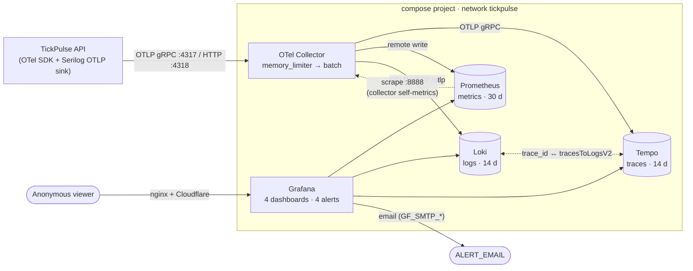

# TickPulse observability stack

Everything TickPulse emits — logs, metrics and traces — leaves the API as OTLP and ends up in Grafana
at `grafana.tickpulse.dev`. The whole stack is code: the collector pipeline, the three backends, and
Grafana's datasources, dashboards and alert rules are all provisioned from this folder. Nothing is
clicked together in the UI.

## Architecture



| Service | Image | Memory limit | Retention | Published port |
|---|---|---|---|---|
| `otel-collector` | `otel/opentelemetry-collector-contrib:0.164.0` | 128M | — | `127.0.0.1:4317` (gRPC), `127.0.0.1:4318` (HTTP) |
| `prometheus` | `prom/prometheus:v3.15.1` | 256M | 30 d (and at most 4 GB) | — |
| `loki` | `grafana/loki:3.7.9` | 256M | 14 d (compactor) | — |
| `tempo` | `grafana/tempo:3.1.1` | 256M | 14 d (`block_retention: 336h`) | — |
| `grafana` | `grafana/grafana:13.3.0` | 256M | — | `127.0.0.1:3000` |

Every image is pinned to an exact release. Go services also get a `GOMEMLIMIT` below their container
limit, so the runtime collects garbage before the kernel kills the container. The collector's
`memory_limiter` (limit 96 MiB, spike 24 MiB) starts refusing data at its 72 MiB soft limit and
forces garbage collection at the 96 MiB hard limit, instead of letting the container be killed.

```
deploy/observability/
├── compose.observability.yml          # the five services, profile "observability"
├── collector/config.yaml              # OTLP in; Tempo / Prometheus / Loki out
├── prometheus/prometheus.yml          # remote-write target + collector self-scrape
├── loki/loki.yaml                     # single binary, tsdb v13, 14 d retention
├── tempo/tempo.yaml                   # single binary, local blocks, 14 d retention
└── grafana/
    ├── provisioning/
    │   ├── datasources/datasources.yaml   # prom, loki, tempo (fixed UIDs) + trace links
    │   ├── dashboards/dashboards.yaml     # file provider → folder "TickPulse"
    │   ├── alerting/                      # rules, email contact point, routing policy
    │   └── plugins/plugins.yaml           # empty on purpose
    └── dashboards/                        # ingestion.json, api.json, runtime.json, logs.json
```

## Running it

With the rest of TickPulse (the root `docker-compose.yml` includes this file):

```bash
docker compose --profile observability up -d
```

On its own, from the repository root:

```bash
docker compose -f deploy/observability/compose.observability.yml --profile observability up -d
docker compose -f deploy/observability/compose.observability.yml --profile observability ps
```

Then open <http://localhost:3000>. The home page is **TickPulse Ingestion**. Anonymous visitors
can view everything, and the admin login is `admin` / `${GRAFANA_ADMIN_PASSWORD:-tickpulse-dev}`.

> **The admin password only takes effect on first boot.** Grafana creates the admin user from
> `GF_SECURITY_ADMIN_PASSWORD` when the `grafana-data` volume is empty. Afterwards the stored password
> wins, and changing the variable does nothing. So:
>
> - **Production must set `GRAFANA_ADMIN_PASSWORD` before the very first start.** The production
>   compose override requires it (`${GRAFANA_ADMIN_PASSWORD:?}`), so a deployment without it fails to start
>   instead of silently getting the local default `tickpulse-dev`.
> - To change it later, run
>   `docker compose exec grafana grafana cli admin reset-admin-password '<new>'`, or recreate the
>   `grafana-data` volume. Nothing else is stored there; everything else is provisioned.

To point an API that runs on the host (`dotnet run`) at the stack, set
`Otel__Endpoint=http://localhost:4317`. Inside the compose network, use `http://otel-collector:4317`.

Tear the stack down and delete its data with `down -v`.

### Environment

| Variable | Default (local only) | Purpose |
|---|---|---|
| `GRAFANA_ADMIN_PASSWORD` | `tickpulse-dev` | Grafana admin password, applied on first boot only (see above). **Required in production.** |
| `GRAFANA_ADMIN_USER` | `admin` | Grafana admin user |
| `GRAFANA_ROOT_URL` | `http://localhost:3000` | `GF_SERVER_ROOT_URL`; `https://grafana.tickpulse.dev` in production |
| `GRAFANA_COOKIE_SECURE` | `false` | `true` behind HTTPS |
| `GRAFANA_BIND`, `GRAFANA_PORT` | `127.0.0.1`, `3000` | Where Grafana is published (the reverse proxy targets it) |
| `OTEL_COLLECTOR_BIND`, `OTEL_GRPC_PORT`, `OTEL_HTTP_PORT` | `127.0.0.1`, `4317`, `4318` | Host ports of the collector |
| `ALERT_EMAIL` | `alerts@example.com` | Alert recipient(s), comma-separated |
| `GF_SMTP_ENABLED`, `GF_SMTP_HOST`, `GF_SMTP_USER`, `GF_SMTP_PASSWORD`, `GF_SMTP_FROM_ADDRESS`, `GF_SMTP_STARTTLS_POLICY` | disabled | SMTP for alert email |

Without SMTP, everything still provisions; Grafana only logs a delivery error when an alert fires.

### Access model

- `GF_AUTH_ANONYMOUS_ENABLED=true` with role **Viewer**: anyone can open the dashboards.
- Viewers cannot edit (`GF_USERS_VIEWERS_CAN_EDIT=false`) and cannot use Explore.
  - Every trace link in the dashboards therefore points at the **Logs** dashboard's trace view
    (`/d/tp-logs/…?var-trace_id=…`), which works for anonymous visitors.
  - Admins additionally get the Explore links (Loki derived field → Tempo, Tempo → "Logs for this trace").
- Provisioned dashboards cannot be saved from the UI (`allowUiUpdates: false`). The JSON in this
  folder is the source of truth.
- Unused bundled datasource plugins are disabled (`GF_PLUGINS_DISABLE_PLUGINS`). Each one would
  run as its own ~15 MiB process inside Grafana's memory limit.
- Snapshots and public dashboards are off (`GF_SNAPSHOTS_ENABLED=false`,
  `GF_PUBLIC_DASHBOARDS_ENABLED=false`), so a visitor cannot publish data out of Grafana.

### Query cost and data exposure

Anonymous Viewers can do anything a dashboard does. In Grafana OSS that includes sending their own
queries to `/api/ds/query`. The stack therefore treats every datasource as public-facing.

**Bounded query cost:**

| Backend | Limits |
|---|---|
| Prometheus | `--query.max-samples=5000000`, `--query.timeout=30s` |
| Loki | `max_query_parallelism: 4`, `max_query_length: 14d`, `max_entries_limit_per_query: 1000`, `query_timeout: 30s` |
| Tempo | `api_timeout: 30s`, search `query_timeout: 30s`, `max_result_limit: 200`, `max_duration: 168h`, `max_concurrent_queries: 8` |

**Read-only data.** The datasource proxy refuses write and delete calls from Viewers (403), and Loki
has `deletion_mode: disabled` anyway. None of the backends is published on a host port.

**No sensitive attributes are stored.** The collector's `attributes/scrub` processor deletes the
following from every span and log record before export:

- `client.address`, `network.peer.address`
- `http.request.header.*`, `http.response.header.*`
- `user_agent.original`
- `url.query`, `url.full`, `url.original`, `http.url`

The API logs IPs only as `client_ip_hash`.

**Rate limiting.** In production, the host nginx in front of `grafana.tickpulse.dev` rate-limits
`/api/ds/query` (and the other `/api/` query paths) per client IP. This bounds how fast anyone can
spend the per-query budgets above.

## What gets provisioned

**Datasources** (fixed UIDs, read-only):

| UID | Type | Notes |
|---|---|---|
| `prom` | Prometheus | default; `timeInterval: 15s` drives `$__rate_interval` |
| `loki` | Loki | derived fields on the `trace_id` structured-metadata label → Tempo, and → the Logs dashboard |
| `tempo` | Tempo | `tracesToLogsV2` → Loki: `{service_name="…"} \| trace_id="<trace>"`; `tracesToMetrics` → Prometheus |

**Dashboards** (folder *TickPulse*, linked to each other by the `tickpulse` tag, UTC, 30 s refresh):

| UID | Title | Rows |
|---|---|---|
| `tp-ingestion` (home) | TickPulse Ingestion | Overview · Throughput · Latency & pipeline · WebSocket · Backfill & gap-fill · Traces |
| `tp-api` | TickPulse API | Overview · RED per route · Status codes & content negotiation · Rate limiting · Traces |
| `tp-runtime` | TickPulse Runtime & DB | Overview · Process · Garbage collector · Thread pool & contention · PostgreSQL (Npgsql) · Telemetry pipeline |
| `tp-logs` | TickPulse Logs | Overview · Log stream · Trace view |

Variables are `symbol` on Ingestion, `route` on API, and `level`, `search` and `trace_id` on Logs.
Thresholds are the same everywhere:

| Measure | Green | Yellow | Red |
|---|---|---|---|
| Ingest lag | < 1 s | 1–5 s | ≥ 5 s |
| Request latency | < 250 ms | 250 ms–1 s | ≥ 1 s |
| Error ratio | < 1 % | 1–2 % | ≥ 2 % |
| Channel depth | < 10 k | 10–50 k | ≥ 50 k |

**Alert rules** (folder *TickPulse*, routed to the *TickPulse email* contact point):

| UID | Condition | Pending | Severity |
|---|---|---|---|
| `tp-ws-disconnected` | WS disconnected > 60 s (alert after a 30 s pending period): the newest `tickpulse_ws_state == 2` (Connected) sample is more than 60 s old, measured by sample timestamp, so it also fires when the API stops exporting | 30 s (fires about 90–110 s after the last Connected report) | critical |
| `tp-ingest-lag-p95` | p95 of `tickpulse_ingest_lag_milliseconds` over 5 m > 5000 | 2 m | warning |
| `tp-zero-ticks` | a symbol with `tickpulse_ingest_symbol_active == 1` received no ticks in the last minute (never-ticked active symbols count as 0) | 5 m (= 6 min of silence) | warning |
| `tp-api-5xx-ratio` | 5xx share of `http_server_request_duration_seconds_count` over 5 m > 2 %, only while traffic > 0.1 req/s | 5 m | critical |

Remote-written series carry **no staleness markers**, so Prometheus keeps answering instant queries
with the last value for 5 minutes after the API stops exporting. Liveness-sensitive queries
therefore never read a bare gauge:

- the WebSocket and leader panels use `last_over_time(…[45s])` (three export intervals), so they
  turn to *Offline* when reports stop;
- the WebSocket alert measures the age of the last Connected sample;
- `tp-zero-ticks` gates on `last_over_time(tickpulse_ingest_symbol_active[45s])`.

Known behaviour of the two ingestion alerts:

- **`tp-ws-disconnected`, cold start.** With no Connected sample in the last hour, the age is
  counted from the API's first `tickpulse_ws_state` sample minus 60 s, so a fresh start has
  2 minutes to connect before the condition becomes true. With the 30 s pending period, that is
  about 2.5 minutes in total.
  - A deploy or failover restart is measured from the previous run's last Connected sample, so a
    gap longer than about 90 s alerts. That is intended.
  - With no `tickpulse_ws_state` sample at all in the last hour (the API has been down for an hour
    or was never started), the rule has no data and **alerts**. A local stack started without the
    API therefore shows this alert after a minute or two.
- **`tp-zero-ticks`, newly added illiquid symbol.** A symbol counts as soon as it is active, even
  before its first trade. A newly added, illiquid symbol that sees no trade for 6 minutes (1-minute
  window + 5-minute pending period) alerts. This is accepted: on Binance spot, a symbol with no trade
  for 6 minutes is unusual enough to look at.

## Telemetry contract (exact series names)

The collector's `prometheus_remote_write` exporter translates OTel names the standard way:

- dots become underscores;
- a unit adds a suffix (`ms` → `_milliseconds`, `s` → `_seconds`, `By` → `_bytes`), while
  annotation units in braces (`{tick}`) add nothing;
- monotonic counters get `_total`, and a literal `total` inside a counter name is dropped
  (`dotnet.gc.heap.total_allocated` → `dotnet_gc_heap_allocated_bytes_total`);
- histograms become `_bucket` / `_sum` / `_count`.

Resource attributes become labels, but only `service.name`, `service.namespace`, `service.version`,
`service.instance.id` and `deployment.environment[.name]` are kept. Every query filters on
`service_name="tickpulse-api"`. Every name below was checked against this stack by pushing OTLP data
with the same name, type and unit.

### TickPulse meter (`TickPulse`)

| OTel instrument | Kind | Unit | Attributes | Prometheus series |
|---|---|---|---|---|
| `tickpulse.ingest.ticks.received` | Counter | `{tick}` | `symbol` | `tickpulse_ingest_ticks_received_total` |
| `tickpulse.ingest.ticks.persisted` | Counter | `{tick}` | `symbol` | `tickpulse_ingest_ticks_persisted_total` |
| `tickpulse.ingest.lag` | Histogram | **`ms`** | — | `tickpulse_ingest_lag_milliseconds_bucket` / `_sum` / `_count` |
| `tickpulse.ingest.channel.depth` | ObservableGauge (or ObservableUpDownCounter) | `{tick}` | — | `tickpulse_ingest_channel_depth` |
| `tickpulse.ingest.batch.size` | Histogram | `{tick}` | — | `tickpulse_ingest_batch_size_bucket` / `_sum` / `_count` |
| `tickpulse.ingest.batch.duration` | Histogram | **`s`** | — | `tickpulse_ingest_batch_duration_seconds_bucket` / `_sum` / `_count` |
| `tickpulse.ws.connections` | Counter | `{connection}` | `reason` = `initial` \| `reconnect` \| `rotation` | `tickpulse_ws_connections_total` |
| `tickpulse.ws.state` | ObservableGauge | none | — | `tickpulse_ws_state` |
| `tickpulse.leader.is_leader` | ObservableGauge | none | — | `tickpulse_leader_is_leader` (0/1) |
| `tickpulse.backfill.candles` | Counter | `{candle}` | `symbol` | `tickpulse_backfill_candles_total` |
| `tickpulse.gapfill.trades` | Counter | `{trade}` | `symbol` | `tickpulse_gapfill_trades_total` |
| `tickpulse.api.responses` | Counter | `{response}` | `route`, `status`, `content_type` | `tickpulse_api_responses_total` |
| `tickpulse.ingest.symbol.active` | ObservableGauge | none | `symbol` | `tickpulse_ingest_symbol_active` (1 while the symbol is monitored; removed symbols report 0 or stop being reported) |

Conventions the dashboards rely on:

- **`tickpulse.ws.state`** reports the `WsState` enum value: `0` Standby, `1` Connecting,
  `2` Connected, `3` Disconnected. The dashboards' value mappings and the WebSocket alert use these numbers.
- Give **no unit, or a braced annotation unit,** to dimensionless instruments. A unit of `"1"`
  would add a `_ratio` suffix.
- **`tickpulse.api.responses`**:
  - `route` is the route template, in the same form as ASP.NET Core's `http.route`
    (`api/{symbol}/24hAvgPrice`), so one `route` variable filters both metric families;
  - `status` is the numeric code as a string (`"200"`, `"429"`);
  - `content_type` is the negotiated media type without parameters (`application/json`,
    `application/xml`, `application/problem+xml`, …), or `none` for an empty body; the XML share
    matches `.*xml.*`;
  - only `/api/…` requests are counted (not the dashboard, the hub, health or docs), and `route` is
    left out when no endpoint matched (a 500 after an unhandled exception keeps the route of the
    endpoint that threw).
- **Ingest lag** is recorded once per stored batch: the lag of its newest tick. A batch with nothing
  new (a gap-fill or rotation replay) records no sample, and neither does a batch whose newest tick
  was received more than 30 s after its trade time (`TickBatchWriter.RecoveredTickAge`: recovered by
  gap-fill over REST, not streamed). The buckets are
  `[50, 100, 250, 500, 1000, 2500, 5000, 10000, 30000]` ms, around the 5 s alert threshold.
- **`tickpulse.ingest.ticks.received`** counts trades from the WebSocket stream only;
  `tickpulse.gapfill.trades` counts the REST recovery. **`ticks.persisted`** counts newly stored ticks
  (replays are not counted). **`backfill.candles`** counts newly stored klines.
- **Export interval 15 s** (the metric reader's export interval).
  The SDK default is 60 s, which is too coarse for 1-minute rate windows, the 45 s liveness windows
  and the 60 s WebSocket alert.
- **`tickpulse.ingest.symbol.active`** reports one series per symbol the instance knows about, and
  only while the instance is the ingestion leader (a standby instance streams nothing and reports no
  series): `1` while the symbol is monitored, then `0` once, at the first export after an admin removed
  it; after that the series is no longer reported, until the symbol is added again. The zero-ticks
  alert only considers symbols at `1`.
- **Exporters are off** when `Otel:Endpoint` is unset or empty. An unreachable or unresolvable
  endpoint only makes the exporters drop data in the background; the API keeps serving and does not
  log the failures.
- **Trace sampling** (`Otel:FlushSampleRatio`, default `0.1`): a parent-based sampler keeps every
  HTTP request (also when the caller sent an unsampled `traceparent`), every `backfill.page` and
  every `gapfill.run`, and the given share of `ingest.flush` traces (by trace id). Any other span
  without a parent, such as the leader lock probe every few seconds, is dropped. Child spans follow
  their parent, so the database spans of an unsampled flush are dropped with it.

### Standard instruments used

| Source | Series |
|---|---|
| ASP.NET Core hosting (`AddAspNetCoreInstrumentation`) | `http_server_request_duration_seconds_bucket` / `_count` (`http_route`, `http_response_status_code`, `http_request_method`), `http_server_active_requests` |
| ASP.NET Core rate limiting (optional meter `Microsoft.AspNetCore.RateLimiting`) | `aspnetcore_rate_limiting_requests_total` (`aspnetcore_rate_limiting_result`, `aspnetcore_rate_limiting_policy`) |
| .NET runtime (`System.Runtime` meter via `AddRuntimeInstrumentation`) | `dotnet_process_cpu_time_seconds_total` (`cpu_mode`), `dotnet_process_cpu_count`, `dotnet_process_memory_working_set_bytes`, `dotnet_gc_collections_total` (`gc_heap_generation`), `dotnet_gc_heap_allocated_bytes_total`, `dotnet_gc_last_collection_heap_size_bytes` (`gc_heap_generation`), `dotnet_gc_last_collection_memory_committed_size_bytes`, `dotnet_gc_pause_time_seconds_total`, `dotnet_thread_pool_thread_count`, `dotnet_thread_pool_queue_length`, `dotnet_thread_pool_work_item_count_total`, `dotnet_monitor_lock_contentions_total`, `dotnet_exceptions_total` (`error_type`) |
| Npgsql 10 (`Npgsql.OpenTelemetry`) | `db_client_operation_duration_seconds_bucket` / `_count`, `db_client_connection_count` (`db_client_connection_state` = `idle` \| `used`), `db_client_connection_max`, `db_client_connection_pending_requests`, `db_client_connection_npgsql_timeouts_total` |
| OTel Collector (scraped, job `otel-collector`) | `otelcol_receiver_accepted_*`, `otelcol_receiver_refused_*`, `otelcol_exporter_send_failed_*`, `otelcol_process_memory_rss` |

The Npgsql panels also accept the older `db_client_connections_*` / `db_client_commands_duration_*`
names, and the collector panels accept both suffixed and unsuffixed names.

### Traces and logs

- **Spans** come from ActivitySource `TickPulse`: `ingest.flush`, `backfill.page` and `gapfill.run`,
  plus the AspNetCore (without `/health/*`, `client.address` and `url.query`), HttpClient and Npgsql
  instrumentation. Span attributes: `tickpulse.batch.size` / `.stored` / `.attempts` on
  `ingest.flush` (Error status when the batch was dropped); `tickpulse.symbol`,
  `tickpulse.backfill.start` (ISO-8601 UTC, e.g. `2026-11-01T12:00:00.0000000Z`) and
  `tickpulse.backfill.fetched` / `.inserted` on `backfill.page`; `tickpulse.symbol` and
  `tickpulse.gapfill.from_id` / `.emitted` / `.complete` on `gapfill.run`. The trace tables search
  with TraceQL, e.g.
  `{ resource.service.name = "tickpulse-api" && name =~ "ingest.flush|backfill.page|gapfill.run" }`.
- **Logs** reach Loki through its native OTLP endpoint.
  - Stream labels: `service_name`, plus Loki's default OTLP resource labels such as
    `deployment_environment`.
  - Structured metadata: log attributes (`symbol`, `client_ip_hash`, …), `trace_id`, `span_id`, and
    `detected_level`, which Loki derives from the OTLP severity.
  - Log queries look like
    `{service_name="tickpulse-api"} | detected_level=~"error|warn" | trace_id="…"`.
  - The trace context must be set on the log record (the Serilog OTLP sink does this inside an
    activity); the `trace_id` link and the trace filter depend on it.
  - Raw IP addresses are never logged, only `client_ip_hash`.
  - Every request logs one line (`Serilog.AspNetCore.RequestLoggingMiddleware`) with `RequestMethod`,
    `RequestPath` (no query string), `StatusCode`, `Elapsed`, `route` and `client_ip_hash`; health
    probes at Debug, 5xx at Error.
  - The console gets the same events as JSON (`RenderedCompactJsonFormatter`) with `service.name`,
    `service.version`, `deployment.environment`, `trace_id` and `span_id` added.
  - Levels come from `Serilog:MinimumLevel` in `appsettings.json`: Information by default; Warning for
    `Npgsql`, `System.Net.Http.HttpClient`, `Polly`, `Microsoft.Extensions.Http.Resilience`,
    `Microsoft.AspNetCore`, `Microsoft.EntityFrameworkCore` and
    `TickPulse.Api.Auth.ApiKeyAuthenticationHandler` (its own failed-attempt warning stays visible).

## Adding a panel

1. Prototype it in Grafana as admin: open the dashboard, choose **Edit**, then **Add → Visualization**.
   Use the `prom`, `loki` or `tempo` datasource, filter on `service_name="tickpulse-api"`, and use
   `$__rate_interval` for `rate()` and `$__range` for totals over the selected time range.
2. Open the panel's menu, choose **Inspect → Panel JSON**, and copy the JSON. Grafana will not save a
   provisioned dashboard, so this JSON is what you keep.
3. Paste it into the dashboard file under `grafana/dashboards/`:
   - inside a row's `panels` array if the row is collapsed, or after the row panel if it is expanded;
   - give it an `id` that is unique in the file and a `gridPos` in the 24-column grid;
   - keep `"datasource": {"type": "prometheus", "uid": "prom"}` (or `loki` / `tempo`) as it is.
4. Reuse the dashboard's units and the thresholds above, and add a one-line `description`, which
   viewers see as the (i) tooltip.
5. Keep the dashboard-level `"id": null`, its `uid` and `"schemaVersion": 42`.
6. Grafana reloads the files within 60 seconds (`updateIntervalSeconds`); no restart is needed.
   Check the result as an anonymous viewer in a private window.

An alert rule needs its `__dashboardUid__` / `__panelId__` annotations updated if you renumber a
linked panel: `tp-ingestion` panels 9, 13 and 19, and `tp-api` panel 10.

## Checking the stack

```bash
F=deploy/observability/compose.observability.yml
docker compose -f $F --profile observability ps            # prometheus, tempo, grafana report (healthy)

curl -s -u "admin:${GRAFANA_ADMIN_PASSWORD:-tickpulse-dev}" localhost:3000/api/datasources | jq -r '.[].uid'          # loki prom tempo
curl -s -u "admin:${GRAFANA_ADMIN_PASSWORD:-tickpulse-dev}" 'localhost:3000/api/search?type=dash-db' | jq -r '.[].uid' # 4 dashboards
curl -s -u "admin:${GRAFANA_ADMIN_PASSWORD:-tickpulse-dev}" localhost:3000/api/v1/provisioning/alert-rules | jq length # 4

# Synthetic traces, logs and metrics straight into the collector:
TG=ghcr.io/open-telemetry/opentelemetry-collector-contrib/telemetrygen:v0.164.0
NET=$(docker network ls --format '{{.Name}}' | grep '_tickpulse$')
docker run --rm --network $NET $TG traces  --otlp-endpoint otel-collector:4317 --otlp-insecure --service tickpulse-api --traces 5
docker run --rm --network $NET $TG logs    --otlp-endpoint otel-collector:4317 --otlp-insecure --service tickpulse-api --logs 5
docker run --rm --network $NET $TG metrics --otlp-endpoint otel-collector:4317 --otlp-insecure --service tickpulse-api --metrics 5 --metric-type Sum
```

The Loki and collector images are distroless (no shell or HTTP client), so compose cannot
health-check them. Check them through Grafana instead: `/api/datasources/uid/loki/health` checks Loki,
and the *Telemetry pipeline* row on the Runtime & DB dashboard shows the collector's accepted and
failed items.
