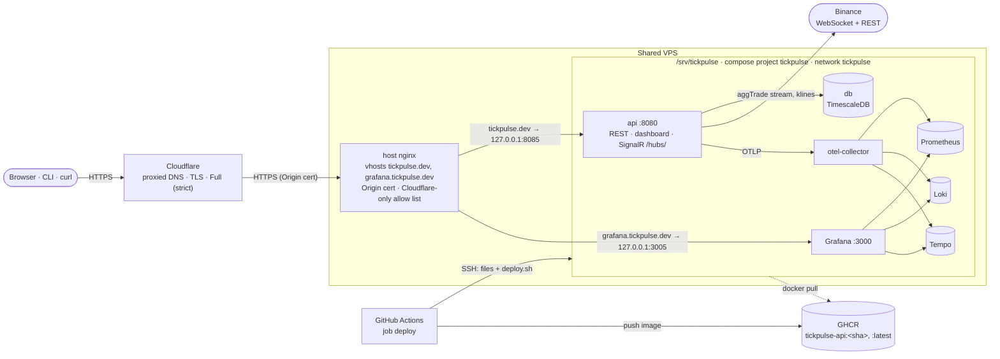

# Deployment

TickPulse runs at <https://tickpulse.dev>, and its Grafana at <https://grafana.tickpulse.dev>. Both
run on a shared VPS behind Cloudflare. The whole deployment is code in this repository:

- the compose project (`deploy/docker-compose.prod.yml`)
- the host nginx vhosts (`deploy/nginx/`)
- the deploy and smoke-test scripts (`deploy/deploy.sh`, `deploy/smoke.sh`)
- the CD job (`deploy` in `.github/workflows/ci.yml`)

## Live topology



- **Cloudflare** holds the DNS records `tickpulse.dev` and `grafana.tickpulse.dev`, both proxied, with SSL
  mode *Full (strict)*. The origin presents a Cloudflare Origin certificate, so only Cloudflare can
  validate it.
- **The host nginx** serves only its two `server_name`-scoped vhosts and changes nothing else on the
  host. It admits only Cloudflare's published ranges and redirects port 80 to HTTPS. It forwards
  `CF-Connecting-IP` and upgrades WebSockets: SignalR on `/hubs/` and Grafana Live on `/api/live/`. It
  also sets HSTS and rate-limits Grafana's query endpoints.
- **The compose project `tickpulse`** runs in `/srv/tickpulse`, on its own bridge network:
  - `db` and `api`
  - the five observability services (`deploy/observability/README.md`)

  Only the api (`127.0.0.1:8085`) and Grafana (`127.0.0.1:3005`) are published, both on loopback. The
  api trusts `CF-Connecting-IP` only from inside the compose network's subnet, which is where the host
  nginx appears from, through the network gateway.

| Service | Image | Memory limit | Published |
|---|---|---|---|
| `db` | `timescale/timescaledb:2.31.0-pg17` (`shared_buffers=128MB`) | 512M | — |
| `api` | `ghcr.io/goofy5752/tickpulse-api:${TICKPULSE_TAG}` | 512M | `127.0.0.1:8085` |
| `otel-collector` | `otel/opentelemetry-collector-contrib:0.164.0` | 128M | — |
| `prometheus` | `prom/prometheus:v3.15.1` | 256M | — |
| `loki` | `grafana/loki:3.7.9` | 256M | — |
| `tempo` | `grafana/tempo:3.1.1` | 256M | — |
| `grafana` | `grafana/grafana:13.3.0` | 256M | `127.0.0.1:3005` |

Every container is set up the same way:

- `restart: unless-stopped`
- `json-file` logs capped at 3 × 50 MB
- a read-only root filesystem, with tmpfs for scratch
- `cap_drop: ALL` and `no-new-privileges`. `db` adds back only what its entrypoint needs to switch to the
  `postgres` user.

Data lives in named volumes: `tickpulse-db`, `prometheus-data`, `loki-data`, `tempo-data` and
`grafana-data`.

Every secret is required (`${VAR:?}`). A missing `.env` entry stops the deploy instead of falling back
to a development default.

### Files

| Repository | Server | Purpose |
|---|---|---|
| `deploy/docker-compose.prod.yml` | `/srv/tickpulse/docker-compose.prod.yml` | the production stack |
| `deploy/observability/` | `/srv/tickpulse/observability/` | collector, Prometheus, Loki, Tempo and Grafana config |
| `deploy/deploy.sh` | `/srv/tickpulse/deploy.sh` | pull, start, smoke test, roll back |
| `deploy/smoke.sh` | `/srv/tickpulse/smoke.sh` | the smoke test |
| — | `/srv/tickpulse/.env` | secrets (chmod 600, never in the repository) |
| — | `/srv/tickpulse/.last_good_tag` | the last tag that passed the smoke test |
| `deploy/nginx/tickpulse.conf` | `/etc/nginx/sites-available/tickpulse.dev` | API and dashboard vhost |
| `deploy/nginx/grafana.tickpulse.conf` | `/etc/nginx/sites-available/grafana.tickpulse.dev` | Grafana vhost |
| `deploy/nginx/tickpulse-http.conf` | `/etc/nginx/conf.d/tickpulse.conf` | http-level maps and the rate-limit zone |
| `deploy/nginx/cloudflare-allow.conf` | `/etc/nginx/snippets/tickpulse-cloudflare-allow.conf` | Cloudflare ranges (allow), everything else denied |
| — | `/etc/ssl/tickpulse/origin.pem`, `origin.key` | Cloudflare Origin certificate (root-only) |

## How a deploy works

The `deploy` job runs on every push to `main` and on a manual run (`workflow_dispatch`), after
`backend` and `web` pass. It uses the GitHub environment `production`, and only one deploy runs at a
time.

1. **Image.** It builds the Dockerfile's `api` target and pushes `ghcr.io/goofy5752/tickpulse-api:<sha>`
   with the GitHub Actions cache. A push to `main` also gets `:latest`.
2. **Gate.** The remaining steps run only when the variable `DEPLOY_ENABLED` is `true` (a repository or
   `production` environment variable). Until the server is set up, `main` builds and publishes images
   and stays green.
3. **Copy.** Over SSH, it copies `docker-compose.prod.yml`, `smoke.sh`, `deploy.sh` and `observability/`
   into a fresh `/srv/tickpulse/.incoming/`. It uses the key and the pinned host key from the
   environment secrets, with strict host-key checking.
4. **Deploy.** It runs `.incoming/deploy.sh --install <sha>`, which works through these steps and stops
   at the first failure:
   1. moves the files into place. `observability/` is replaced only when its content changed, and then
      its containers are recreated, because compose cannot see changes inside bind-mounted config
      files.
   2. `docker compose -f docker-compose.prod.yml --env-file .env pull`. If the pull fails, the job stops
      here and the running stack is unchanged.
   3. `up -d --remove-orphans`.
   4. waits up to 90 s for `/health/ready` on `127.0.0.1:8085` to return 200.
   5. runs `./smoke.sh http://127.0.0.1:8085`, retrying for up to 120 s, so a first start on an empty
      database has time for its first complete 1-minute candle.

   On success, it writes the sha to `.last_good_tag` and deletes the older local tags of the api image,
   keeping the new tag and the rollback target.
5. **Rollback.** If step 3 or a later one fails, `deploy.sh` redeploys the tag in `.last_good_tag` and
   smoke-tests it again. The job fails either way, so a rolled-back deploy is never green.
   - A rollback restores the api image, not the copied files: the compose file and `observability/` stay
     at the new version.
   - Exit codes:

     | Code | Meaning |
     |---|---|
     | 1 | failed and rolled back, or there was nothing to roll back to |
     | 2 | bad usage or setup |
     | 3 | the rollback failed as well |

`smoke.sh <base-url> [wait-seconds]` needs only bash, curl and grep. It works against
`http://127.0.0.1:8085` on the server and against `https://tickpulse.dev` from anywhere. It checks:

| Request | Expected |
|---|---|
| `GET /health/ready` | 200 |
| `GET /api/BTCUSDT/24hAvgPrice` | 200 `application/json` with `sampleCount` |
| the same with `Accept: application/xml` | 200 `application/xml` with `<sampleCount>` |
| `GET /api/BTCUSDT/SimpleMovingAverage?n=5&p=1m` | 200 |
| `GET /api/NOPEUSDT/24hAvgPrice` with `Accept: application/xml` | 404 `application/problem+xml`, `unknown-symbol` |
| `GET /` | 200 `text/html`, the dashboard |

Every failed check prints one `FAIL` line, and the script exits non-zero.

## First-time server setup

These are one-time steps for the owner. The host is a shared VPS, so every step touches only TickPulse's
own files, and nginx is only ever reloaded gracefully after `nginx -t` passes.

**Requirements on the host:**

- Docker Engine with Docker Compose **2.24.4 or newer** (the prod compose uses `!reset` / `!override`)
- nginx 1.18 or newer, with `conf.d/*.conf` and `sites-enabled/*` included inside `http {}`, as Debian and
  Ubuntu set it up
- `curl` and `diff`

1. **Domain.** Register `tickpulse.dev` and use Cloudflare as its DNS.
2. **DNS.** Add `A tickpulse.dev` and `A grafana.tickpulse.dev`, both **proxied**, pointing at the VPS.
   Set SSL/TLS to **Full (strict)** and turn on *Always Use HTTPS*.
3. **Origin certificate.** In Cloudflare, under *SSL/TLS → Origin Server*, create a certificate for
   `tickpulse.dev` and `*.tickpulse.dev`. On the VPS, as root:

   ```bash
   install -d -m 700 /etc/ssl/tickpulse
   # paste the certificate and the key
   install -m 600 /dev/stdin /etc/ssl/tickpulse/origin.pem
   install -m 600 /dev/stdin /etc/ssl/tickpulse/origin.key
   ```

4. **Deploy user and directory.** Create an unprivileged `deploy` user in the `docker` group, with no
   sudo and key-only SSH login, then the deploy directory:

   ```bash
   install -d -o deploy -g deploy -m 750 /srv/tickpulse
   ```

   Membership in `docker` is root-equivalent on the host, so keep this key in the GitHub environment and
   nowhere else.
5. **`.env`.** Create `/srv/tickpulse/.env` as `deploy`, with mode 600:

   ```dotenv
   # Required
   POSTGRES_PASSWORD=<long random, letters and digits only>
   ADMIN_API_KEY=<long random>
   GRAFANA_ADMIN_PASSWORD=<long random; applied on Grafana's first start only>
   # Optional
   OTEL_IP_SALT=<random; keeps the daily client-IP hashes stable across restarts>
   TICKPULSE_SUBNET=172.30.0.0/24          # change if another network on the host uses it
   ALERT_EMAIL=<alert recipient>
   GF_SMTP_ENABLED=true
   GF_SMTP_HOST=<smtp host:port>
   GF_SMTP_USER=<smtp user>
   GF_SMTP_PASSWORD=<smtp password>
   GF_SMTP_FROM_ADDRESS=alerts@tickpulse.dev
   ```

   Check that the subnet is free with
   `docker network inspect $(docker network ls -q) --format '{{.Name}} {{range .IPAM.Config}}{{.Subnet}}{{end}}'`.
6. **nginx.** Copy the four files from `deploy/nginx/` to the server, then, as root:

   ```bash
   # note the status codes of the sites already on the host
   for h in <each existing site>; do curl -s -o /dev/null -w "$h %{http_code}\n" "https://$h/"; done

   install -m 644 tickpulse-http.conf     /etc/nginx/conf.d/tickpulse.conf
   install -m 644 cloudflare-allow.conf   /etc/nginx/snippets/tickpulse-cloudflare-allow.conf
   install -m 644 tickpulse.conf          /etc/nginx/sites-available/tickpulse.dev
   install -m 644 grafana.tickpulse.conf  /etc/nginx/sites-available/grafana.tickpulse.dev
   ln -s /etc/nginx/sites-available/tickpulse.dev         /etc/nginx/sites-enabled/
   ln -s /etc/nginx/sites-available/grafana.tickpulse.dev /etc/nginx/sites-enabled/
   nginx -t && systemctl reload nginx

   # the same sites answer with the same codes
   for h in <each existing site>; do curl -s -o /dev/null -w "$h %{http_code}\n" "https://$h/"; done
   ```

   `tickpulse-http.conf` must go into `conf.d/`, because `map` and `limit_req_zone` are allowed only at
   the http level. Every name it defines starts with `tickpulse`, so it cannot collide with another
   site's configuration.
7. **GitHub environment.** Under *Settings → Environments*, create `production` with these secrets:

   | Secret | Value |
   |---|---|
   | `DEPLOY_HOST` | the VPS hostname or IP |
   | `DEPLOY_USER` | `deploy` |
   | `DEPLOY_SSH_KEY` | a dedicated private key whose public half is in `~deploy/.ssh/authorized_keys` |
   | `DEPLOY_KNOWN_HOSTS` | the host's key lines, from `ssh-keyscan -t ed25519 <host>`, checked against the host's own fingerprint |

   Optionally, restrict the environment to the `main` branch and add required reviewers.
8. **Enable the deploy.** Add the variable `DEPLOY_ENABLED` = `true`, on the `production` environment or
   the repository. Re-run the latest `main` workflow, or start *CI* with *Run workflow*.
9. **Public image.** After the first push, set the GHCR package `tickpulse-api` to **public**
   (*Package settings → Change visibility*), so the server pulls without credentials. Until then the
   pull fails, and the job stops at step 2 without touching the server's stack.
10. **Verify.**

    ```bash
    ./deploy/smoke.sh https://tickpulse.dev
    curl -s https://tickpulse.dev/api/BTCUSDT/24hAvgPrice
    curl -s -H "Accept: application/xml" https://tickpulse.dev/api/BTCUSDT/24hAvgPrice
    ```

    Open <https://grafana.tickpulse.dev> in a private window. It should show *TickPulse Ingestion* without
    a login.
11. **Uptime check.** Create a free external monitor (for example UptimeRobot) on
    `https://tickpulse.dev/health/ready`, with email alerts.

## Operations

Run these on the server as `deploy`, in `/srv/tickpulse`. The compose file needs the running tag:

```bash
cd /srv/tickpulse
export TICKPULSE_TAG=$(cat .last_good_tag)
alias dc='docker compose -f docker-compose.prod.yml --env-file .env'
```

| Task | Command |
|---|---|
| Status | `dc ps` |
| Logs | `dc logs -f --tail 200 api` (or `db`, `grafana`, …); everything is also in Loki, on the *TickPulse Logs* dashboard |
| Restart the api | `dc restart api` |
| Restart everything | `dc up -d --force-recreate` |
| Smoke test | `./smoke.sh http://127.0.0.1:8085` |
| Roll back | `./deploy.sh <older sha>` deploys any tag still in GHCR with the same checks; `./deploy.sh "$(cat .last_good_tag)"` redeploys the current one |
| psql | `docker exec -it tickpulse-db-1 psql -U tickpulse -d tickpulse` |
| Reset the Grafana admin password | `dc exec grafana grafana cli admin reset-admin-password '<new>'` |

A manual deploy or rollback takes the files already in place. To change the files themselves, push to
`main`.

### Database backup and restore

The backup is a custom-format dump, streamed out of the container. There is no `-t`, because a TTY
would corrupt the binary stream.

```bash
install -d -m 700 ~/backups
docker exec tickpulse-db-1 pg_dump -U tickpulse -d tickpulse -Fc > ~/backups/tickpulse-$(date -u +%Y%m%dT%H%MZ).dump
```

A daily copy, keeping 14 days, as a crontab line for `deploy`:

```cron
15 3 * * * docker exec tickpulse-db-1 pg_dump -U tickpulse -d tickpulse -Fc > "$HOME/backups/tickpulse-$(date -u +\%Y\%m\%d).dump" && find "$HOME/backups" -name 'tickpulse-*.dump' -mtime +14 -delete
```

The raw ticks are kept for 14 days and the candles indefinitely, so the dump stays small. Copy it off
the host as well.

To restore, follow TimescaleDB's procedure (`timescaledb_pre_restore` / `timescaledb_post_restore`),
with the api stopped:

```bash
dc stop api
docker exec tickpulse-db-1 psql -U tickpulse -d postgres -c 'DROP DATABASE tickpulse WITH (FORCE)' -c 'CREATE DATABASE tickpulse'
docker exec tickpulse-db-1 psql -U tickpulse -d tickpulse -c 'CREATE EXTENSION IF NOT EXISTS timescaledb' -c 'SELECT timescaledb_pre_restore()'
docker exec -i tickpulse-db-1 pg_restore -U tickpulse -d tickpulse --no-owner < ~/backups/<file>.dump
docker exec tickpulse-db-1 psql -U tickpulse -d tickpulse -c 'SELECT timescaledb_post_restore()'
dc start api
```

### Maintenance

- **Cloudflare ranges.** `deploy/nginx/cloudflare-allow.conf` holds Cloudflare's published ranges, and
  its header has the command that diffs them against the current list. When they change, update the
  file, copy it to the server, then run `nginx -t && systemctl reload nginx`.
- **nginx vhosts.** The CD job does not copy them. After changing one, install it the way step 6 does.
- **Secrets.**
  - To rotate `ADMIN_API_KEY`, edit `.env`, then run `dc up -d api`.
  - `POSTGRES_PASSWORD` applies only when the volume is first created. To change it later, run
    `ALTER USER tickpulse PASSWORD '…'` in psql first, then update `.env` and run `dc up -d api`.
  - The Grafana admin password works the same way; reset it with the command in the table above.
- **Disk.**
  - `docker system df` shows Docker's usage.
  - Logs are capped by the json-file limits.
  - Prometheus keeps 30 days and at most 4 GB, and Loki and Tempo keep 14 days.
  - `deploy.sh` keeps only two api image tags.
