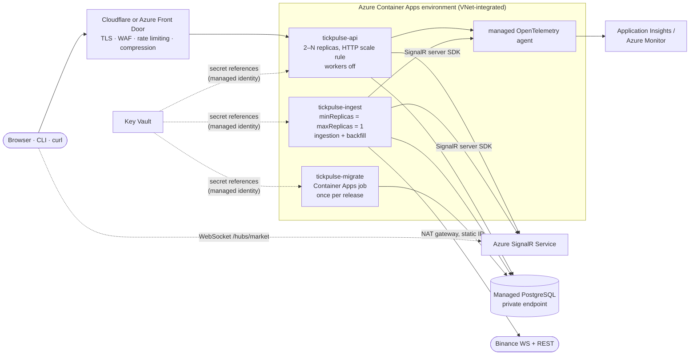

# Deployment

TickPulse is designed to run at <https://tickpulse.dev>, with its Grafana at
<https://grafana.tickpulse.dev>, both on a shared VPS behind Cloudflare. The deployment pipeline is
ready. The first deploy waits on the owner's one-time steps in
[First-time server setup](#first-time-server-setup) (domain, DNS, certificate, deploy user and
secrets). The topology below is the target that pipeline deploys. The whole deployment is code in
this repository:

- the compose project (`deploy/docker-compose.prod.yml`)
- the host nginx vhosts (`deploy/nginx/`)
- the deploy and smoke-test scripts (`deploy/deploy.sh`, `deploy/smoke.sh`)
- the CD jobs (`image` and `deploy` in `.github/workflows/ci.yml`)

How TickPulse would run with more than one instance, on managed services, is in
[Scale-out production design](#scale-out-production-design) at the end.

## Single-host topology


- **Cloudflare** holds the DNS records `tickpulse.dev` and `grafana.tickpulse.dev`, both proxied, with SSL
  mode *Full (strict)*. The origin presents a Cloudflare Origin certificate, so only Cloudflare can
  validate it.
- **The host nginx** serves only its two `server_name`-scoped vhosts and changes nothing else on the
  host. It admits only Cloudflare's published ranges and redirects port 80 to HTTPS. It forwards
  `CF-Connecting-IP` and upgrades WebSockets: SignalR on `/hubs/` and Grafana Live on `/api/live/`. It
  also sets HSTS and rate-limits Grafana's query endpoints.
  - The vhosts listen with plain `listen 443 ssl`, without `http2`. On nginx 1.18, `http2` is a property
    of the shared listening socket and would switch HTTP/2 on for every site on 443. Visitors still get
    HTTP/2 and HTTP/3 from Cloudflare; only the hop from Cloudflare to the origin is HTTP/1.1.
  - They declare no `default_server`. nginx then treats the first server block it loads for a port as
    that port's default, which answers unknown names and decides socket-wide TLS settings. The host must
    therefore keep its own explicit `default_server` on 80 and 443 (setup step 6 checks it).
- **The compose project `tickpulse`** runs in `/srv/tickpulse`, on its own bridge network:
  - `db` and `api`
  - the five observability services (`deploy/observability/README.md`)

  Only the api (`127.0.0.1:8085`) and Grafana (`127.0.0.1:3005`) are published, both on loopback. The host
  nginx reaches them through docker-proxy, which connects from the network's gateway. The api trusts
  `CF-Connecting-IP` from that one address only (`ForwardedHeaders__KnownNetworks` is
  `${TICKPULSE_GATEWAY}/32`), not from the other containers.

| Service | Image | Memory limit | Published |
|---|---|---|---|
| `db` | `timescale/timescaledb:2.31.0-pg17` (`shared_buffers=128MB`) | 512M | — |
| `api` | `ghcr.io/goofy5752/tickpulse-api:${TICKPULSE_TAG}` | 512M | `127.0.0.1:8085` |
| `otel-collector` | `otel/opentelemetry-collector-contrib:0.164.0` | 128M | — |
| `prometheus` | `prom/prometheus:v3.15.1` | 256M | — |
| `loki` | `grafana/loki:3.7.9` | 256M | — |
| `tempo` | `grafana/tempo:3.1.1` | 256M | — |
| `grafana` | `grafana/grafana:13.3.0` | 256M | `127.0.0.1:3005` |

Every container is set up the same way:

- `restart: unless-stopped`
- `json-file` logs capped at 3 × 50 MB
- a read-only root filesystem, with tmpfs for scratch
- `cap_drop: ALL` and `no-new-privileges`. `db` adds back only what its entrypoint needs to switch to the
  `postgres` user.

Data lives in named volumes: `tickpulse-db`, `prometheus-data`, `loki-data`, `tempo-data` and
`grafana-data`.

Every secret is required (`${VAR:?}`). A missing `.env` entry stops the deploy instead of falling back
to a development default.

### Files

| Repository | Server | Purpose |
|---|---|---|
| `deploy/docker-compose.prod.yml` | `/srv/tickpulse/docker-compose.prod.yml` | the production stack |
| `deploy/observability/` | `/srv/tickpulse/observability/` | collector, Prometheus, Loki, Tempo and Grafana config |
| `deploy/deploy.sh` | `/srv/tickpulse/deploy.sh` | pull, start, smoke test, roll back |
| `deploy/smoke.sh` | `/srv/tickpulse/smoke.sh` | the smoke test |
| — | `/srv/tickpulse/.env` | secrets (chmod 600, never in the repository) |
| — | `/srv/tickpulse/.last_good_tag` | the last tag that passed the smoke test |
| — | `/srv/tickpulse/.previous/` | the compose file, scripts and `observability/` from before the last install, for its rollback |
| — | `/srv/tickpulse/.incoming/` | the CD upload; afterwards it holds `deploy.log` and `deploy.exit` of the last CD deploy |
| — | `/srv/tickpulse/.deploy.lock` | the `flock` lock that allows one deploy at a time |
| — | `/srv/tickpulse/.failed-<time>/` | the files of a deploy that was rolled back, deleted after the next successful deploy |
| `deploy/nginx/tickpulse.conf` | `/etc/nginx/sites-available/tickpulse.dev` | API and dashboard vhost |
| `deploy/nginx/grafana.tickpulse.conf` | `/etc/nginx/sites-available/grafana.tickpulse.dev` | Grafana vhost |
| `deploy/nginx/tickpulse-http.conf` | `/etc/nginx/conf.d/tickpulse.conf` | http-level maps and the rate-limit zone |
| `deploy/nginx/cloudflare-allow.conf` | `/etc/nginx/snippets/tickpulse-cloudflare-allow.conf` | Cloudflare ranges (allow), everything else denied |
| — | `/etc/ssl/tickpulse/origin.pem`, `origin.key` | Cloudflare Origin certificate (root-only) |

## How a deploy works

CD is two jobs in `.github/workflows/ci.yml`. Both run after `backend` and `web` pass, on every push to
`main` and on a manual run (`workflow_dispatch`). Every action is pinned to a full commit sha, and
Dependabot keeps the pins current. Push and manual runs are never cancelled by a newer run, so a deploy
is never cut off halfway; only pull-request runs are superseded.

1. **`image`** builds the Dockerfile's `api` target and pushes `ghcr.io/goofy5752/tickpulse-api:<sha>`,
   using the GitHub Actions cache. A push to `main` also gets `:latest`. This job holds the only write
   token (`packages: write`), runs the docker actions, and has no environment and no deploy secrets.
2. **`deploy`** runs only when the **repository** variable `DEPLOY_ENABLED` is `true`. A job-level
   condition cannot read environment variables, so it has to be a repository variable. Until the server
   is set up, `main` builds and publishes images and stays green.
   - It runs in the `production` environment with `contents: read` only, and uses no third-party
     action: plain `ssh` and `scp`, with the key and the pinned host key from the environment secrets and
     strict host-key checking.
   - Only one deploy runs at a time.
   - It goes through these steps:
     1. **Upload.** Under the server's deploy lock, it empties `/srv/tickpulse/.incoming/`, then copies
        `docker-compose.prod.yml`, `smoke.sh`, `deploy.sh` and `observability/` into it.
     2. **Start.** It runs `.incoming/deploy.sh --detach --install <sha>`. The script runs on in its own
        session (`nohup setsid`), so a dropped SSH connection cannot stop it halfway. Its output goes to
        `.incoming/deploy.log` and its exit code to `.incoming/deploy.exit`.
     3. **Follow.** It polls those two files every 5 s, streams the log into the job log, and fails if
        there is no result within 20 minutes.

On the server, `deploy.sh` works through these steps and stops at the first failure:

1. **Lock.** It takes `.deploy.lock` (`flock`). A second deploy is refused.
2. **Validate.** It runs `docker compose config` with the *uploaded* compose file and `.env`, and
   `bash -n` on the uploaded scripts. Nothing has changed yet, so an invalid upload is refused (exit 2)
   with the running stack and its files untouched.
3. **Pull.** It pulls every image for `<sha>` with the uploaded compose file. A failed pull also changes
   nothing (exit 1).
4. **Install.** The live compose file and scripts move to `.previous/`, and the uploaded ones take their
   place. For `observability/`:
   - if it is unchanged, it stays where it is, and `.previous/` gets a copy;
   - if it changed, the old directory is *renamed* into `.previous/`, never deleted, and the new one
     takes its place. The running containers keep reading the old files (the same inodes) until step 5
     recreates them on the new ones.

   Compose cannot see changes inside bind-mounted files, which is why `deploy.sh` does this itself.
5. **Start.** `up -d --remove-orphans`, and when `observability/` changed,
   `up -d --no-deps --force-recreate` of its five services.
6. **Ready.** It waits up to 90 s for `/health/ready` on `127.0.0.1:8085` to return 200.
7. **Smoke.** It runs `./smoke.sh http://127.0.0.1:8085`, retrying for up to 120 s, so a first start on an
   empty database has time for its first complete 1-minute candle.
8. **Done.** On success, it writes the sha to `.last_good_tag`, deletes leftover `.failed-*` directories,
   and deletes the older local tags of the api image, keeping the new tag and the rollback target.

**Rollback.** If step 5, 6 or 7 fails:

1. The failed files are renamed into `.failed-<time>/`.
2. The files in `.previous/` are put back: the compose file, the scripts, and `observability/` if it
   differs, whose containers are then recreated again.
3. The tag in `.last_good_tag` is started and smoke-tested again.

The job fails either way, so a rolled-back deploy is never green.

| Exit code | Meaning |
|---|---|
| 0 | deployed |
| 1 | failed and rolled back, there was nothing to roll back to, or the pull failed (nothing changed) |
| 2 | refused: bad usage, invalid upload, missing `.env`, or another deploy running; nothing changed |
| 3 | failed, and the rollback failed as well |

`smoke.sh <base-url> [wait-seconds]` needs only bash, curl and grep. It works against
`http://127.0.0.1:8085` on the server and against `https://tickpulse.dev` from anywhere. It checks:

| Request | Expected |
|---|---|
| `GET /health/ready` | 200 |
| `GET /api/BTCUSDT/24hAvgPrice` | 200 `application/json` with `sampleCount` |
| the same with `Accept: application/xml` | 200 `application/xml` with `<sampleCount>` |
| `GET /api/BTCUSDT/SimpleMovingAverage?n=5&p=1m` | 200 |
| `GET /api/NOPEUSDT/24hAvgPrice` with `Accept: application/xml` | 404 `application/problem+xml`, `unknown-symbol` |
| `GET /` | 200 `text/html`, the dashboard |

Every failed check prints one `FAIL` line, and the script exits non-zero.

## First-time server setup

These are one-time steps for the owner. The host is a shared VPS, so every step touches only TickPulse's
own files, and nginx is only ever reloaded gracefully after `nginx -t` passes.

**Requirements on the host:**

- Docker Engine with Docker Compose **2.24.4 or newer** (the prod compose uses `!reset` / `!override`)
- nginx 1.18 or newer, with `conf.d/*.conf` and `sites-enabled/*` included inside `http {}`, as Debian and
  Ubuntu set it up
- `bash`, `curl`, `diff`, and `flock`, `setsid` and `nohup` (util-linux and coreutils)

1. **Domain.** Register `tickpulse.dev` and use Cloudflare as its DNS.
2. **DNS.** Add `A tickpulse.dev` and `A grafana.tickpulse.dev`, both **proxied**, pointing at the VPS.
   Set SSL/TLS to **Full (strict)** and turn on *Always Use HTTPS*.
3. **Origin certificate.** In Cloudflare, under *SSL/TLS → Origin Server*, create a certificate for
   `tickpulse.dev` and `*.tickpulse.dev`. On the VPS, as root:

   ```bash
   install -d -m 700 /etc/ssl/tickpulse
   # paste the certificate and the key
   install -m 600 /dev/stdin /etc/ssl/tickpulse/origin.pem
   install -m 600 /dev/stdin /etc/ssl/tickpulse/origin.key
   ```

4. **Deploy user and directory.** Create an unprivileged `deploy` user in the `docker` group, with no
   sudo and key-only SSH login, then the deploy directory:

   ```bash
   install -d -o deploy -g deploy -m 750 /srv/tickpulse
   ```

   Membership in `docker` is root-equivalent on the host, so keep this key in the GitHub environment and
   nowhere else.
5. **`.env`.** Create `/srv/tickpulse/.env` as `deploy`, with mode 600:

   ```dotenv
   # Required
   POSTGRES_PASSWORD=<long random, letters and digits only>
   ADMIN_API_KEY=<long random, at least 32 characters; a shorter key fails startup>
   GRAFANA_ADMIN_PASSWORD=<long random; applied on Grafana's first start only>
   # Optional
   OTEL_IP_SALT=<random; keeps the daily client-IP hashes stable across restarts>
   TICKPULSE_SUBNET=172.30.0.0/24          # change if another network on the host uses it,
   TICKPULSE_GATEWAY=172.30.0.1            # together with its gateway (the only trusted proxy)
   ALERT_EMAIL=<alert recipient>
   GF_SMTP_ENABLED=true
   GF_SMTP_HOST=<smtp host:port>
   GF_SMTP_USER=<smtp user>
   GF_SMTP_PASSWORD=<smtp password>
   GF_SMTP_FROM_ADDRESS=alerts@tickpulse.dev
   ```

   Check that the subnet is free with
   `docker network inspect $(docker network ls -q) --format '{{.Name}} {{range .IPAM.Config}}{{.Subnet}}{{end}}'`.
6. **nginx.** Copy the four files from `deploy/nginx/` to the server, then, as root:

   ```bash
   # the host must already have an explicit default server on 80 and on 443 (see "Single-host topology"):
   # expect a default_server line for each port
   nginx -T 2> /dev/null | grep -E 'listen .*(80|443).*default_server'

   # note the status codes of the sites already on the host
   for h in <each existing site>; do curl -s -o /dev/null -w "$h %{http_code}\n" "https://$h/"; done

   install -m 644 tickpulse-http.conf     /etc/nginx/conf.d/tickpulse.conf
   install -m 644 cloudflare-allow.conf   /etc/nginx/snippets/tickpulse-cloudflare-allow.conf
   install -m 644 tickpulse.conf          /etc/nginx/sites-available/tickpulse.dev
   install -m 644 grafana.tickpulse.conf  /etc/nginx/sites-available/grafana.tickpulse.dev
   ln -s /etc/nginx/sites-available/tickpulse.dev         /etc/nginx/sites-enabled/
   ln -s /etc/nginx/sites-available/grafana.tickpulse.dev /etc/nginx/sites-enabled/
   nginx -t && systemctl reload nginx

   # the same sites answer with the same codes
   for h in <each existing site>; do curl -s -o /dev/null -w "$h %{http_code}\n" "https://$h/"; done
   ```

   `tickpulse-http.conf` must go into `conf.d/`, because `map` and `limit_req_zone` are allowed only at
   the http level. Every name it defines starts with `tickpulse`, so it cannot collide with another
   site's configuration.

   If the `grep` finds no `default_server` for a port, give the host's own default site one first. That
   is a separate change to that site, made on purpose. Otherwise whichever server block nginx loads first
   for that port, possibly one of these vhosts, becomes the default and answers requests for unknown
   names.
7. **GitHub environment.** Under *Settings → Environments*, create `production` with these secrets:

   | Secret | Value |
   |---|---|
   | `DEPLOY_HOST` | the VPS hostname or IP |
   | `DEPLOY_USER` | `deploy` |
   | `DEPLOY_SSH_KEY` | a dedicated private key whose public half is in `~deploy/.ssh/authorized_keys` |
   | `DEPLOY_KNOWN_HOSTS` | the host's key lines, from `ssh-keyscan -t ed25519 <host>`, checked against the host's own fingerprint |

8. **Public image.** A push to `main` runs the `image` job even before the deploy is enabled, which
   creates the GHCR package `tickpulse-api`. Set it to **public** (*Package settings → Change
   visibility*), so the server pulls without credentials. Check it from any machine, logged out:
   `docker pull ghcr.io/goofy5752/tickpulse-api:latest`. A deploy against a private package would fail at
   the pull and change nothing.
9. **Enable the deploy.** Add the **repository** variable `DEPLOY_ENABLED` = `true`, under *Settings →
   Secrets and variables → Actions → Variables*. It must be a repository variable, not an environment
   variable, because the `deploy` job's condition is checked before the environment is loaded. Then
   re-run the latest `main` workflow, or start *CI* with *Run workflow*.
10. **Verify.**

    ```bash
    ./deploy/smoke.sh https://tickpulse.dev
    curl -s https://tickpulse.dev/api/BTCUSDT/24hAvgPrice
    curl -s -H "Accept: application/xml" https://tickpulse.dev/api/BTCUSDT/24hAvgPrice
    ```

    Open <https://grafana.tickpulse.dev> in a private window. It should show *TickPulse Ingestion* without
    a login.
11. **Rollback drill.** Check the rollback once, end to end:
    1. On a throwaway branch (for example `drill/rollback`), make `/health/ready` fail.
    2. Start *CI* on that branch with *Run workflow*. The `deploy` job must log a failed ready check or
       smoke test, roll back to the previous sha, and fail, while <https://tickpulse.dev> stays up.
    3. Delete the branch.
12. **Protect the environment.** After the drill, restrict `production` to the branches that may deploy,
    under *Deployment branches and tags → Selected branches*: `main`, plus the drill branch pattern
    (`drill/*`) for future drills. A manual run from any other branch then cannot reach the deploy
    secrets. Add required reviewers if deploys should wait for an approval.
13. **Uptime check.** Create a free external monitor (for example UptimeRobot) on
    `https://tickpulse.dev/health/ready`, with email alerts.

## Operations

Run these on the server as `deploy`, in `/srv/tickpulse`. The compose file needs the running tag:

```bash
cd /srv/tickpulse
export TICKPULSE_TAG=$(cat .last_good_tag)
alias dc='docker compose -f docker-compose.prod.yml --env-file .env'
```

| Task | Command |
|---|---|
| Status | `dc ps` |
| Logs | `dc logs -f --tail 200 api` (or `db`, `grafana`, …); everything is also in Loki, on the *TickPulse Logs* dashboard |
| Restart the api | `dc restart api` |
| Restart everything | `dc up -d --force-recreate` |
| Smoke test | `./smoke.sh http://127.0.0.1:8085` |
| Roll back | `./deploy.sh <older sha>` deploys any tag still in GHCR with the same checks; `./deploy.sh "$(cat .last_good_tag)"` redeploys the current one |
| psql | `docker exec -it tickpulse-db-1 psql -U tickpulse -d tickpulse` |
| Reset the Grafana admin password | `dc exec grafana grafana cli admin reset-admin-password '<new>'` |

A manual deploy or rollback uses the files already in place, and takes the same deploy lock as the CD job.
To change the files themselves, push to `main`. The output of the last CD deploy stays in
`.incoming/deploy.log` until the next one.

### Database backup and restore

The backup is a custom-format dump, streamed out of the container. There is no `-t`, because a TTY
would corrupt the binary stream.

```bash
install -d -m 700 ~/backups
docker exec tickpulse-db-1 pg_dump -U tickpulse -d tickpulse -Fc > ~/backups/tickpulse-$(date -u +%Y%m%dT%H%MZ).dump
```

A daily copy, keeping 14 days, as a crontab line for `deploy`:

```cron
15 3 * * * docker exec tickpulse-db-1 pg_dump -U tickpulse -d tickpulse -Fc > "$HOME/backups/tickpulse-$(date -u +\%Y\%m\%d).dump" && find "$HOME/backups" -name 'tickpulse-*.dump' -mtime +14 -delete
```

The raw ticks are kept for 14 days and the candles indefinitely, so the dump stays small. Copy it off
the host as well.

To restore, follow TimescaleDB's procedure (`timescaledb_pre_restore` / `timescaledb_post_restore`),
with the api stopped:

```bash
dc stop api
docker exec tickpulse-db-1 psql -U tickpulse -d postgres -c 'DROP DATABASE tickpulse WITH (FORCE)' -c 'CREATE DATABASE tickpulse'
docker exec tickpulse-db-1 psql -U tickpulse -d tickpulse -c 'CREATE EXTENSION IF NOT EXISTS timescaledb' -c 'SELECT timescaledb_pre_restore()'
docker exec -i tickpulse-db-1 pg_restore -U tickpulse -d tickpulse --no-owner < ~/backups/<file>.dump
docker exec tickpulse-db-1 psql -U tickpulse -d tickpulse -c 'SELECT timescaledb_post_restore()'
dc start api
```

### Maintenance

- **Cloudflare ranges.** `deploy/nginx/cloudflare-allow.conf` holds Cloudflare's published ranges, and
  its header has the command that diffs them against the current list. When they change, update the
  file, copy it to the server, then run `nginx -t && systemctl reload nginx`.
- **nginx vhosts.** The CD job does not copy them. After changing one, install it the way step 6 does.
- **Secrets.**
  - To rotate `ADMIN_API_KEY`, edit `.env`, then run `dc up -d api`.
  - Since #23, Production refuses admin keys under 32 characters. Check with
    `awk '/^ADMIN_API_KEY=/{print length(substr($0, 15))}' .env` before deploying; rotate if under 32.
    `deploy.sh` runs the same check before it pulls and refuses the deploy (exit 2, nothing changed).
  - `POSTGRES_PASSWORD` applies only when the volume is first created. To change it later, run
    `ALTER USER tickpulse PASSWORD '…'` in psql first, then update `.env` and run `dc up -d api`.
  - The Grafana admin password works the same way; reset it with the command in the table above.
- **Disk.**
  - `docker system df` shows Docker's usage.
  - Logs are capped by the json-file limits.
  - Prometheus keeps 30 days and at most 4 GB, and Loki and Tempo keep 14 days.
  - `deploy.sh` keeps only two api image tags.

## Scale-out production design

The single-host deployment above is one API container and one database on one host. This section
describes how TickPulse would run when it has to survive the loss of a host, serve more traffic than
one container handles, and be operated by more than one person. It targets Azure; the same shape works
on any platform with managed containers and managed PostgreSQL.

What holds today is narrow. Running several instances is safe, because a PostgreSQL advisory lock
lets exactly one of them ingest at a time and the others stand by
([ADR 0011](adr/0011-single-process-with-a-leader-lock.md)). Scaling out is **not** a configuration
change, though. API-only replicas and live prices on every replica need the code changes listed in
[Code changes this design needs](#code-changes-this-design-needs): a setting that skips the workers, a
SignalR backplane, leader-only pushes, and the rest. The HTTP contract and the data model stay as
they are.



### Compute: Azure Container Apps

Two apps from the same image, plus a job:

- **`tickpulse-api`**: the API, the dashboard and the hub's server side. `minReplicas: 2` across
  availability zones, an HTTP scale rule on concurrent requests, and the hosted workers switched off
  (code change 1).
  - For sizing: on the local stack, with telemetry off, one API container served `24hAvgPrice` at
    about 6,400 req/s with a p95 of 12.7 ms, using 241 % CPU (about 2.4 cores) and 101 MiB.
  - Its memory peaked at 324 MiB in the run with telemetry on.
  - Start with 1 GiB per replica, and set the CPU and the scale rule from the production metrics
    rather than from these numbers.
- **`tickpulse-ingest`**: the same image with ingestion and backfill on and no public ingress,
  `minReplicas = maxReplicas = 1`. Ingestion gets its own CPU, so API load cannot raise ingest lag.
- **`tickpulse-migrate`**: a Container Apps job that runs the migrations before a release. Both apps
  run with `Database__RunMigrationsOnStartup=false`.

The leader lock stays in force in this layout. `maxReplicas = 1` is not a guarantee: during a revision
change, or when the platform replaces a replica, two ingest replicas can run for a while. Only the
lock holder ingests; the other stands by (`/health/ready` reports `Standby`, which counts as ready) and
takes over within `Ingestion:LeaderRetryInterval` once the lock frees. The gap-fill then recovers the
trades missed during the handover ([ADR 0022](adr/0022-gap-fill-watermarks-seeded-from-the-database.md)).

The simpler variant, one app in which every replica runs the workers and the lock elects one, needs no
code change to be *safe*: there is still exactly one writer. It is not a complete scale-out, though:
- Without the backplane, only browsers connected to the leader's replica get live prices.
- `/api/system/stats` on the other replicas reports `Standby`.
- Ingestion shares CPU with whichever replica holds the lock.

### Live prices across replicas: Azure SignalR Service

With one process, the broadcaster that sends live prices runs where the ingestion state is. With
several API replicas, a browser is connected to any one of them, and only the ingest leader has the
prices. Azure SignalR Service (`AddSignalR().AddAzureSignalR(...)`) solves this: every app server's hub
context sends through the service, and the service delivers to the clients in each group, whichever
replica negotiated their connection. Clients hold their WebSocket to the service, so the API replicas
carry no long-lived connections either.

Two adjustments come with it:

- Only the ingestion leader runs the price and stats push loops. Otherwise each API replica would push
  its own `stats` (as `Standby`, with zero ticks/s) to every client.
- `/api/system/stats` on an API replica must report the leader's ingestion state, not its own. The
  leader can publish a small heartbeat row (status, lag, ticks/s, next rotation) every few seconds,
  which every replica reads.

### Managed PostgreSQL

Checked on 2026-11-04 against the providers' documentation:

| Option | TimescaleDB | What TickPulse needs to change |
|---|---|---|
| **Azure Database for PostgreSQL – Flexible Server** | PostgreSQL 17 is generally available. TimescaleDB is the **Apache-2 edition**, version 2.24.0 on PostgreSQL 15–18 ([extension versions](https://learn.microsoft.com/en-us/azure/postgresql/extensions/concepts-extensions-versions), [considerations](https://learn.microsoft.com/en-us/azure/postgresql/extensions/concepts-extensions-considerations)). | Compression, the compression and retention policies, and continuous aggregates are not available. The initial migration's `ALTER TABLE … SET (timescaledb.compress …)`, `add_compression_policy` and `add_retention_policy` fail there and must run only when `current_setting('timescaledb.license') = 'timescale'`. Retention becomes a scheduled `drop_chunks('price_ticks', older_than => INTERVAL '14 days')`, from `pg_cron` (available on Flexible Server) or an app-side job. |
| **Tiger Cloud** (Timescale's managed service) | Full TimescaleDB, including the TSL features. Runs on AWS and Azure; its Azure regions include `germanywestcentral` and `westeurope` ([supported regions](https://www.tigerdata.com/docs/get-started/supported-regions)). | Nothing in the schema. Connectivity from the Container Apps VNet, and a second vendor to operate. |
| **Plain PostgreSQL** with native partitioning | None. | `price_ticks` becomes `PARTITION BY RANGE (trade_time)` with daily partitions (`pg_partman` is available on Flexible Server); retention drops old partitions. `time_bucket(width, ts, origin)` becomes `date_bin(width, ts, origin)` (PostgreSQL 14+), with the same Monday origin, in the queries and the rollup triggers. |

The queries depend on no TSL feature ([ADR 0012](adr/0012-own-candle-table-not-a-continuous-aggregate.md)),
so the analytics answer the same on all three. The cost of losing compression is storage. Measured on
the local stack, a tick takes about 190 bytes with its indexes and a minute candle about 134 bytes. At
the 22 ticks/s that the three seeded symbols produced, 14 days of uncompressed ticks are roughly 5 GB;
candles grow by about 70 MB per symbol per year.

**Extension privileges.** The migration runs `CREATE EXTENSION IF NOT EXISTS timescaledb`, which needs
the privilege to create the extension, and managed services grant no superuser. On Flexible Server the
extension must be allow-listed (`azure.extensions`), added to `shared_preload_libraries` (a server
restart), and created once by the server admin, a member of `azure_pg_admin`. Do that before the first
migration, and run the application under a separate, non-admin role that owns the TickPulse schema; the
`IF NOT EXISTS` then makes that statement a no-op. Flexible Server's in-place major-version upgrade
does not support `timescaledb` for every version, so a major upgrade means a dump and restore or a
new server.

### Releases: blue-green revisions

Both apps run in **multiple-revision mode** with labels
([blue-green deployment](https://learn.microsoft.com/en-us/azure/container-apps/blue-green-deployment)):

1. CI builds and pushes `tickpulse-api:<sha>`, as today.
2. The `tickpulse-migrate` job applies the new migrations. They must be backward compatible with the
   running release (expand now, contract in a later release), because the old revision keeps serving
   during the switch. The candle rollups are maintained by triggers partly for this reason: an older
   image writing minutes keeps them correct ([ADR 0015](adr/0015-candle-rollups-maintained-by-triggers.md)).
3. A new `tickpulse-api` revision, suffixed with the short sha and labelled `green`, starts with 0 %
   traffic. `deploy/smoke.sh https://<green label FQDN>` runs the same checks as today.
4. Traffic moves to `green`, all at once or 10 % → 50 % → 100 % while the 5xx ratio and latency are
   watched. Rolling back is moving the weight back to `blue`.
5. `tickpulse-ingest` gets its new revision last. The leader lock makes the overlap safe, and the
   gap-fill covers the handover.

### Secrets: Key Vault

`Admin__ApiKey`, the database password and the IP-hash salt (`Otel__IpSalt`) live in Key Vault. The
apps reference them as Container Apps secrets through a user-assigned managed identity, so no secret is
stored in the app definition or the pipeline. Rotating a secret is a new Key Vault version and a new
revision. The database login can later move to Microsoft Entra ID tokens (Npgsql supports a periodic
password provider), which removes the password altogether.

### Observability: Application Insights over OpenTelemetry

The application already exports traces, metrics and logs over OTLP when `Otel:Endpoint` is set, so it
needs no change. Two ways to receive them:

- Keep the stack from `deploy/observability/` (OTel Collector, Prometheus, Loki, Tempo, Grafana) as
  container apps with Azure Files volumes, and keep the dashboards and alerts as they are.
- Point `Otel__Endpoint` at the environment's managed OpenTelemetry agent
  ([OpenTelemetry agents](https://learn.microsoft.com/en-us/azure/container-apps/opentelemetry-agents)),
  which forwards traces and logs to Application Insights. The agent is in preview, and its Application
  Insights destination accepts no metrics, so metrics need a second destination (an OTLP endpoint such
  as the collector above). The Grafana dashboards and alert rules would then be rebuilt on Azure
  Monitor.

Request sampling ([ADR 0016](adr/0016-request-sampling-with-429-as-a-sampled-response.md)) applies per
replica, so the traced request rate is `Otel:SampledRequestsPerSecond` times the replica count.

### Backup and restore

- **Point-in-time restore.** Flexible Server takes automated backups with point-in-time restore
  (retention configurable up to 35 days) and optional geo-redundant backup storage. A restore creates a
  new server; the apps switch over by changing the connection string secret.
- **Logical dumps** (`pg_dump -Fc`, as in the [backup runbook](#database-backup-and-restore) above), kept
  outside the server, for portability between providers. On Flexible Server,
  `timescaledb_post_restore()` can fail on the restricted `ALTER DATABASE` permission; Microsoft
  documents `timescaledb-backup` (`ts-dump`, `ts-restore`) as the workaround.
- **What matters most.** Raw ticks are kept for 14 days. Candles are kept forever, and stream minutes
  carry an exact `price_sum` and `tick_count` that a later backfill cannot reproduce (klines have
  neither), so the candle tables are the data to protect.
- **Drills.** Restore into a scratch server every quarter and run the smoke test against an app
  revision pointed at it.

### Network and edge

- The Container Apps environment is VNet-integrated, and PostgreSQL is reachable only through a private
  endpoint.
- Outbound traffic goes through a NAT gateway with a static IP. Binance meters REST weight per IP, and
  the ingest leader is the only heavy caller, so one stable IP keeps the weight accounting predictable.
- Rate limiting is in memory per replica, so the effective limit grows with the replica count. Keep a
  per-client limit at the edge (Cloudflare, or a Front Door WAF rule) as the real one.
- TickPulse takes the client IP from `CF-Connecting-IP`, from trusted proxies only. Behind Cloudflare
  that stays as it is, with `ForwardedHeaders__KnownNetworks` set to the environment's infrastructure
  subnet. Behind Front Door alone, the client-IP header would have to become configurable.
- Compression stays at the edge ([ADR 0017](adr/0017-build-time-precompressed-static-assets.md)).

### Code changes this design needs

1. A setting that skips registering the ingestion and backfill workers, for API-only replicas.
2. Push loops on the ingestion leader only, and `/api/system/stats` from a leader heartbeat.
3. `AddAzureSignalR` behind configuration, so the single-host deployment keeps the in-process hub.
4. TSL-conditional migration steps and a `drop_chunks` retention job, for Apache-only TimescaleDB.
5. A configurable client-IP header, if Front Door replaces Cloudflare.
