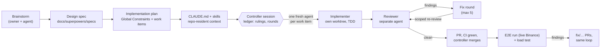

# Engineering notes

How TickPulse was built, why it looks the way it does, how the AI-generated code was checked, and
what is still open. Read the [README](README.md) first for what TickPulse does and how to run it.

TickPulse is designed to run at <https://tickpulse.dev>. The deployment pipeline is ready, and the
first deploy is pending the owner's steps in [docs/deployment.md](docs/deployment.md#first-time-server-setup).
Every measurement below therefore comes from the local stack running against live Binance.

## Approach

TickPulse had to be correct before it was clever: one ingestion path that never double-counts and
never silently loses a trade, two analytics endpoints whose numbers can be checked against Binance,
and the same errors and contracts in JSON and XML. Everything else (backfill, dashboard, Grafana,
CD) was built on top of that core, in that order.

Four principles shaped it:

1. **One process, one database.** An API with hosted workers, PostgreSQL 17 with TimescaleDB, and a
   leader lock for the single writer. No broker and no second service: complexity has to earn its
   place, and nothing here needed one.
2. **Decide ambiguities explicitly.** Where the product could be read more than one way (what "average
   price" means, which way `s` anchors the window, what a data point is), the decision and the
   rejected reading are written down as ADRs, and the API reports enough (`coveredSeconds`,
   `actualDataPoints`, `windowStart`) for a client to see which reading was applied.
3. **Exactness over approximation.** `decimal` end to end, banker's rounding to 8 dp, idempotent
   writes keyed on Binance's aggregate trade id, and a 24h average that reads candles and is tested
   equal to a raw `AVG(price)`.
4. **Test against real things.** Real TimescaleDB in every integration test, a fake Binance server that
   enforces Binance's rules, and finally the real Binance and a real browser.

## Key decisions

The full list is in [docs/adr/](docs/adr/README.md). The ones that shape the code most:

| Decision | Why it matters |
|---|---|
| [`aggTrade` as the feed](docs/adr/0001-aggtrade-stream-as-price-feed.md) | A total order per symbol, so replays are idempotent and gaps can be refilled by id |
| [Arithmetic mean of collected trades](docs/adr/0002-24h-average-is-the-arithmetic-mean.md), [with coverage](docs/adr/0003-partial-window-reports-its-coverage.md) | The 24h number is reproducible from stored data and honest about how much data it covers |
| [Bucket close, Monday weeks](docs/adr/0004-sma-data-point-is-the-bucket-close.md), [`s` as start](docs/adr/0005-sma-start-parameter-anchors-the-window-start.md), [skip empty buckets](docs/adr/0006-sparse-buckets-are-skipped-not-filled.md) | SMA values match Binance's klines exactly |
| [Switchable backfill, SMA only](docs/adr/0007-switchable-kline-backfill-for-sma-only.md) | Long periods work from day one without touching the 24h average |
| [Single process with a leader lock](docs/adr/0011-single-process-with-a-leader-lock.md) | Exactly one writer at any time, so running several instances is safe today; API-only replicas and live prices on every replica still need [code changes](docs/deployment.md#code-changes-this-design-needs) |
| [Own candle table](docs/adr/0012-own-candle-table-not-a-continuous-aggregate.md), [rollups by triggers](docs/adr/0015-candle-rollups-maintained-by-triggers.md) | Backfill can write candles; no query depends on a TimescaleDB TSL feature |
| [MVC for XML](docs/adr/0013-mvc-controllers-for-xml-negotiation.md), [naming parity](docs/adr/0021-xml-element-names-match-json-property-names.md) | Every success and every error is negotiated, with one vocabulary |
| [Workers never crash the host](docs/adr/0020-hosted-workers-never-crash-the-host.md) | A bug in a background worker cannot take the public API down |
| [Watermarks seeded from the DB](docs/adr/0022-gap-fill-watermarks-seeded-from-the-database.md) | Restarts, redeploys and handovers recover the trades they missed |

## How the work was done with AI agents

TickPulse was built with Claude Code as a personal engineering practice: the owner set direction,
made the product decisions and approved the design; agents wrote the code, the tests and most of the
documentation; and every change was reviewed, by agents and by measurement, before it merged. The
process, in order:

1. **Brainstorm and spec.** One design session turned the product goals into
   [the design spec](docs/superpowers/specs/2026-11-03-tickpulse-design.md): ten open questions with a
   decision and a rejected alternative each, the architecture, the testing strategy, CI/CD and the
   observability stack. The owner decided scope, hosting and visual direction; the agent proposed the
   rest and the owner approved it.
2. **Plan.** [The implementation plan](docs/superpowers/plans/2026-11-03-tickpulse.md) split the work
   into numbered items with exact files, tests and commands, under a block of **Global Constraints**
   (money is `decimal`, all clock reads go through `TimeProvider`, the fixed routes, the config keys,
   the week origin) that every agent had to follow.
3. **Repo-resident context.** [CLAUDE.md](CLAUDE.md) and three skills under `.claude/skills/`
   (`tickpulse-architecture`, `tickpulse-testing`, `tickpulse-pr-workflow`) carry the layering rules,
   invariants, test conventions and the PR procedure, so a fresh agent starts with the same context as
   the last one.
4. **Subagent-driven execution.** A controller session ran the plan. For each work item it wrote a
   prompt (the shared rules plus the item's own instructions and any carried-over notes) and dispatched
   a **fresh implementer** with no memory of earlier items. Each implementer worked in its own git
   worktree and branch, wrote the tests first, and returned a report with its RED and GREEN evidence.
5. **Review by a separate agent.** A different agent reviewed each item against the spec and for code
   quality. Findings went back as a fix round; the **re-review was scoped to the fix diff**. Fix rounds
   were capped at 5 per item. A loop that kept finding new problems was escalated: the next round went
   to a fresh implementer on a more capable model, instead of the same agent trying again.
6. **A ledger of rulings.** Before execution, a pre-flight scan checked what each plan item produced
   against what later items consumed. It found gaps and conflicts (an interface nobody implemented, a
   test placed in a layer that could not reference the code, two items creating the same file), and
   the first ten rulings settled them, each with its cost if wrong. By the end the ledger held 40 rulings
   (R1–R40), for example R17 (temp-table staging), R18 (atomic symbol add), R23 (workers never crash
   the host) and R36 (429 sampled like a success).
7. **Model tiering.** Mechanical items and scoped re-reviews ran on a smaller model; standard
   integration work and ordinary reviews on a larger one; the hardest reviews (the gap-fill state
   machine, for one) on the largest.
8. **Parallel worktrees.** Independent slices ran at the same time in separate worktrees: the domain
   model beside the bootstrap fixes, the WebSocket client beside persistence, the dashboard beside the
   API, the CLI, containers and instrumentation side by side.
9. **Controller-only merges.** Agents never merged. The controller opened each PR, waited for CI
   (`backend` and `web`) to pass and squash-merged it.
10. **End-to-end verification.** After the features merged, a separate run brought up the full stack against
    real Binance and checked everything a user would touch, then load-tested it. Each finding became a
    `fix/…` PR that went through the same implement, review and re-review loop.

Some of the owner's prompts were written in Bulgarian. [docs/ai/prompts.md](docs/ai/prompts.md) gives
them all in English, with excerpts of the agent prompts and why each is shaped the way it is.

## How AI-generated code was validated

No agent's claim that something worked was taken at face value. Every claim had to come with
evidence that could be re-run.

- **TDD with RED and GREEN evidence.** Each report shows the failing run before the change and the
  passing run after it, with the command and an excerpt of the output.
- **Mutation checks.** Where a test could pass for the wrong reason, the fix was reverted or mutated to
  prove the test fails without it. Examples: removing the replay floor fails two tick-writer tests;
  removing the post-reconcile gap-fill fails `ResubscribeAckLost_*`; running the rollup tests without
  the day lock fails the overlapping-transaction test.
- **Real TimescaleDB.** Integration tests run on Testcontainers with `timescale/timescaledb:2.31.0-pg17`,
  the same image as production, with the real migrations. There is no in-memory database anywhere.
- **A fake Binance server.** A Kestrel server inside the test process speaks the combined-stream
  protocol and the REST endpoints. It enforces the 5 msg/s limit, can drop acks, pause `aggTrades`,
  abort connections and serve klines exactly the way Binance pages them. Reconnects, rotations,
  gap-fill and backfill are tested against it, on a fake clock.
- **Architecture tests.** NetArchTest enforces the layering (Domain ← Application ← Infrastructure ←
  Api; Cli → Contracts only).
- **Live Binance checks.** SMA values were compared with Binance's own klines: BTCUSDT `1d n=20` was
  `80407.33600000` on both sides, with all 20 closes identical, and the other periods and symbols
  matched as well.
- **Load tests.** `autocannon` and a fetch-based script at 50 connections for 30 s per endpoint, with
  telemetry off (handler latency) and on (production config).
- **Automated security scan.** The CD pipeline was scanned; it flagged the unpinned third-party actions
  ([RV-25](docs/ai/defects-log.md#rv-25)).

### By the numbers

Figures marked *as of 2026-11-04* are the state when the last fix PRs had merged.

| | |
|---|---|
| .NET tests on `main` | **1,088**, all passing, as of 2026-11-04: Domain 56, Application 133, Cli 100, Architecture 13, Integration 786 |
| Web tests | **148** in 18 files (Vitest), all passing, as of 2026-11-04 |
| Line coverage | **93.8 %** overall, as of 2026-11-04; Domain 100 %, Application 98.2 %, Api 95.1 %, Infrastructure 93.3 %, Cli 91.6 % (gates: Domain ≥ 95 %, overall ≥ 80 %) |
| Pull requests | **20 merged** (#1–#20) after the bootstrap commit, plus the final documentation PR, as of 2026-11-04 |
| Reviews | **27** first reviews (21 for plan items, 6 for end-to-end fix PRs) and **33** completed fix rounds, each followed by a scoped re-review, as of 2026-11-04 |
| Defects caught in review | **41 Important** findings in the plan-item reviews and re-reviews; **3 Critical and 7 Important** in the reviews of the fix PRs, as of 2026-11-04 |
| End-to-end run | **55 checks**, 48 passed and 7 failed on the first run. **19 findings** (F1–F19): 1 Critical, 6 Important, 12 Minor, all fixed except the limitation tracked as [issue #19](https://github.com/goofy5752/tickpulse/issues/19). F18 and F19 showed up only under the heavier load that followed. |
| Latency after fixes | p95 12.7 ms for `24hAvgPrice` at 6.4k req/s; 12–21 ms for 1d/1w SMA and candles (was up to 1,368 ms) |
| Ingest lag | p95 803 ms, trade time to persisted, target < 1 s |
| Dashboard | first contentful paint 48 ms on the local stack |

The test and coverage numbers are from `main` at `ef670ad`. The latency, lag and paint numbers are
from the end-to-end run (the local stack against live Binance) and the rollup fix's before/after
measurement.

## Issues and defects caught

The full, curated list with root causes and guarding tests is the
[defects log](docs/ai/defects-log.md). Four issues were caught at design time, before any code:

- **XML problems.** In ASP.NET Core only controller `Problem()` results are content-negotiated. The
  401 from the auth handler, the 429 from the rate limiter, unmatched routes, unhandled exceptions and
  the 406 itself go through `IProblemDetailsService`, whose writer is JSON-only. The design therefore
  includes a custom XML problem writer and a problem body for the 406, with tests for each path
  ([ADR 0013](docs/adr/0013-mvc-controllers-for-xml-negotiation.md)).
- **Duplicate ticks counted twice.** Reconnect overlaps, the 23 h make-before-break rotation and
  gap-fill all deliver some trades twice. The primary key `(symbol_id, agg_trade_id, trade_time)` with
  `ON CONFLICT DO NOTHING` makes the tick insert idempotent, and only the rows that were really inserted
  feed the candle merge. Review later found the one case this missed: a replay of a tick that retention
  had already dropped ([RV-02](docs/ai/defects-log.md#rv-02)).
- **`DateTimeOffset` in XML.** `DataContractSerializer` writes `DateTimeOffset` as a complex type with
  `DateTime` and `OffsetMinutes` children. Every DTO timestamp is therefore a UTC `DateTime`, and both
  formats carry ISO-8601 with `Z`.
- **Timescale licensing.** Compression, retention policies and continuous aggregates are TSL features,
  missing from Apache-only managed offerings. No query depends on them, candles are our own tables, and
  the [scale-out design](docs/deployment.md#managed-postgresql) shows what changes on such a service.

Examples of what the reviews caught during implementation:

- data loss: a transient database failure dropping a batch ([RV-08](docs/ai/defects-log.md#rv-08)), a
  resubscribe that was never gap-filled ([RV-09](docs/ai/defects-log.md#rv-09)), a rotation committed
  over a rejected subscribe ([RV-10](docs/ai/defects-log.md#rv-10));
- availability: a cancelled command killing the WebSocket ([RV-05](docs/ai/defects-log.md#rv-05)), an
  unexpected worker error stopping the host ([RV-12](docs/ai/defects-log.md#rv-12)), a slow stats query
  stalling live prices ([RV-19](docs/ai/defects-log.md#rv-19));
- security: a key-length timing leak ([RV-17](docs/ai/defects-log.md#rv-17)), the CLI echoing the API key
  ([RV-20](docs/ai/defects-log.md#rv-20)), anonymous Grafana queries without limits
  ([RV-22](docs/ai/defects-log.md#rv-22)), unpinned CI actions ([RV-25](docs/ai/defects-log.md#rv-25));
- operations: a rollback that did not restore the deployed files ([RV-27](docs/ai/defects-log.md#rv-27)),
  `http2` on a shared port ([RV-26](docs/ai/defects-log.md#rv-26)).

The end-to-end run found what unit and integration tests could not: telemetry collapsing under load
([F1](docs/ai/defects-log.md#f1)), trades lost across process restarts
([F2](docs/ai/defects-log.md#f2)), a 24h change that was wrong during backfill
([F3](docs/ai/defects-log.md#f3)), long-period queries over budget ([F4](docs/ai/defects-log.md#f4)). Under
heavier load it found two more: a native crash in the database driver's GSS probe
([F18](docs/ai/defects-log.md#f18)), and, once that was fixed, a local connection pool larger than the
database's `max_connections` ([F19](docs/ai/defects-log.md#f19)).

Two lessons from this:

- **Separate reviewers find real defects.** Every plan item's review led to at least one fix round, and
  ([F2](docs/ai/defects-log.md#f2)) is the clearest case. It took 5 review rounds, and most of them found a
  new loss path in the fix itself. After the third, the loop was escalated: a fresh implementer on a more
  capable model wrote down the model first (what may move a watermark, and why), and replaced the
  accumulated flags with one rule. The remaining hole is tracked as
  [issue #19](https://github.com/goofy5752/tickpulse/issues/19).
- **Tests pass on what they model.** The fake Binance server never restarted the process, so no test
  noticed that watermarks lived in memory. The end-to-end run, a real restart and a comparison of trade ids
  with Binance did.

## Trade-offs

- **One process.** API and ingestion share CPU and memory. That keeps deployment trivial, and the
  leader lock makes running several instances safe, at the cost of ingestion competing with API load on
  one host. A real scale-out needs the code changes listed in the
  [scale-out design](docs/deployment.md#code-changes-this-design-needs).
- **Arithmetic mean, not VWAP.** Simple and reproducible, but different from Binance's own
  volume-weighted figures.
- **Backfill on by default in compose and production.** Long-period SMAs work from day one, at the
  cost of 263 REST calls per symbol and about 2 minutes of `Running` status per symbol (262,080
  klines).
- **Triggers for rollups.** Exact and writer-independent, at the cost of SQL that only works under a
  documented locking invariant.
- **Sampled request telemetry.** The pipeline survives bursts, but individual successful requests
  beyond 10/s are not in Loki or Tempo.
- **Admin by one API key.** Fine for one operator; there are no users, roles or audit trail.

## Known limitations

- One poison tick fails its whole multi-symbol batch. The batch is retried, then dropped and recovered
  by gap-fill, but a single bad row could be isolated instead.
- While the database is down and the leader lock holds, back-pressure stops reading the WebSocket, and
  Binance eventually disconnects. Recovery is through gap-fill, at most 50,000 trades per symbol per
  trigger.
- A gap-fill hole known only to another, or a crashed, process is not visible to the next leader's seed
  ([issue #19](https://github.com/goofy5752/tickpulse/issues/19)).
- A deactivation within the reconcile latency of a minute boundary can, rarely, make a trailing stream
  minute the end of the inactive stretch, so that stretch is not backfilled.
- The status lag in `/api/system/stats` and `/health` can spike when a gap-fill batch is written, because
  recovered trades count as lag.
- Symbols backfill one after another, at about 2 minutes each, so after a fresh start the third seeded
  symbol has its long-period SMAs about 6 minutes after start.
- Admin calls share the public rate limit.

## What's next

1. Close the limitation tracked as [issue #19](https://github.com/goofy5752/tickpulse/issues/19): a gap-fill
   hole that only another, or a crashed, process knew about.
2. Deploy to `tickpulse.dev` and run the rollback drill and the external uptime check from the
   [deployment guide](docs/deployment.md).
3. Isolate poison ticks per row instead of per batch.
4. A setting to run API-only replicas without the hosted workers, as the first step of the
   [scale-out design](docs/deployment.md#scale-out-production-design).
5. Make the TSL-only migration steps conditional, so TickPulse runs on Apache-only managed PostgreSQL.
6. A separate rate limit for authenticated admin calls.
